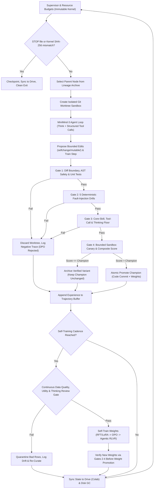

# Self-Maintaining & Bounded Self-Modifying MiniMind-3 (`selfchange`) Engineering Plan

## 1. Executive Vision & Containment Invariants

### 1.1 Goal
Build a closed-loop, self-maintaining, and bounded self-modifying autonomous LLM system inside `selfchange/` using this `minimind` repository as its foundation. The system continuously:
1. **Runs and monitors itself** across operational and training cycles, capturing structured telemetry, logs, and execution traces.
2. **Diagnoses and recovers from failures** (OOM, NaN/Inf loss, syntax/test regressions, corrupted checkpoints, malformed tool calls, stalled progress, VM disconnects).
3. **Improves its own bounded harness/policy code and hyperparameters** inside isolated `git worktree` sandboxes, promoted only after passing an immutable 4-tier verifier and archived in a Darwin Gödel Machine (DGM)-style lineage tree.
4. **Trains its own MiniMind-3 weights** via Rejection-Sampled Fine-Tuning (RFT / LoRA), Direct Preference Optimization (DPO), and Agentic Reinforcement Learning with Verifiable Rewards (RLVR via GRPO / CISPO) so the model gets measurably better at operating, healing, and refining itself over successive generations.
5. **Specializes & compresses the general-purpose base model onto the minimal viable CPU model + continuously reviews fine-tuning data** by cutting useless world trivia to reclaim parameter capacity, injecting high-signal coding/debugging/systems knowledge, deepening structured `<think>` reasoning, using Google Colab GPUs to accelerate architecture search and domain distillation down to the **smallest model that runs continuous self-change natively on local CPU** (target ~10M–30M), and gating every fine-tuning dataset through an automated continuous review loop.

### 1.2 Operational Definition of "Better Keep Itself Run on Its Own"
Self-preservation and autonomy in `selfchange/` are strictly defined as **operational resilience, fault recovery, and reproducible self-improvement** inside user-owned boundaries:
- Detecting and recovering from hardware memory pressure (VRAM/RAM OOM), numerical instability (`NaN`/`Inf` loss or gradient spikes), and runtime exceptions.
- Diagnosing and repairing broken mutable policy/training modules in an isolated `git worktree` using structured file inspection and narrow search-and-replace edits.
- Detecting and recovering from truncated or corrupted checkpoints (critical on Google Colab disconnects) and resuming cleanly from Google Drive state.
- Avoiding catastrophic forgetting, mode collapse, or endless malformed `<tool_call>` loops by continuously curating execution traces into self-training updates.

### 1.3 Hard Safety & Containment Invariants (Non-Negotiable)
1. **Immutable Trusted Computing Base (`selfchange/kernel/`)**: All supervision, budget enforcement, worktree management, AST policy scanning, fault-injection drills, checkpoint/lineage management, and grading live in `selfchange/kernel/`. Before every cycle, `integrity.py` verifies SHA-256 hashes of all kernel files against a signed/pinned manifest; any mismatch halts execution immediately.
2. **Unconditional Shutdown & Human Kill Switch**: The supervisor checks `selfchange/workspace/STOP` before every cycle and sub-step, honors `SIGINT`/`SIGTERM`, and enforces hard wall-clock, disk, RAM/VRAM, and max-cycle limits. The agent has zero mechanism or permission to ignore, suppress, or bypass stop signals or resource limits.
3. **Strict Filesystem & Diff Boundary**: Candidate code execution occurs exclusively inside ephemeral `git worktree` directories under `selfchange/workspace/worktrees/`, and runtime state writes only under `selfchange/workspace/`. A strict `git diff --name-only` gate rejects any candidate patch that touches files outside `selfchange/mutable/`.
4. **No Arbitrary Shell / No Outbound Network in Evaluation**: The MiniMind agent interacts solely through a fixed, typed tool API—never raw `bash`/`sh`. Mutable modules undergo AST static analysis prior to execution to reject forbidden imports and calls (`subprocess`, `socket`, `urllib`, `requests`, `http`, `ctypes`, `eval`, `exec`, `compile`, `__import__`, `os.system`, `os.popen`, `shutil.rmtree` outside workspace).
5. **Immutable Evaluation & Anti-Reward-Hacking**: Reward computation, deterministic fault-injection drills, and regression benchmarks are owned by `selfchange/kernel/`; the model cannot modify test fixtures, grading thresholds, or reward formulas.

---

## 2. Repository Baseline & Repo-Specific Constraints

### 2.1 Reuse Map of Existing `minimind` Components

| Existing Repo Component | Role in `selfchange/` | Notes / Adaptation Needed |
|---|---|---|
| `model/model_minimind.py` | Core `MiniMindConfig` & `MiniMindForCausalLM` (64M Dense: `hidden_size=768`, `num_hidden_layers=8`, `num_attention_heads=8`, `num_key_value_heads=4`, `vocab_size=6400`) | Reused directly; Intel CPU tests also instantiate a 2M micro-model config (`hidden_size=128`, `num_hidden_layers=4`). |
| `model/model_lora.py` | Low-rank self-training (`LoRA`, `apply_lora`, `load_lora`, `save_lora`, `merge_lora`) | Reused for fast RFT cycles; `merge_lora` promotes verified LoRA adapters into updated base `.pth` weights. |
| `model/tokenizer_config.json` | Chat template & special tokens (`<|im_start|>`, `<|im_end|>`, `<think>`, `</think>`, `<tool_call>`, `</tool_call>`, `<tool_response>`, `</tool_response>`, `open_thinking`) | Used verbatim without retraining tokenizer (preserving `vocab_size=6400` weight compatibility). |
| `dataset/lm_dataset.py` | `SFTDataset`, `DPODataset`, `AgentRLDataset` | Reused for warm-start SFT, self-play DPO preference tuning, and multi-turn RLVR rollouts; enforced strictly by `selfchange/bootstrap/data_quality.py` (5-key SFT struct & schema gate). |
| `trainer/train_lora.py` & `trainer/train_full_sft.py` | Supervised fine-tuning on curated trajectories and synthetic traces | Wrapped by `selfchange/training/self_train_runner.py` to inject profile precision, absolute paths, and structured exit telemetry. |
| `trainer/train_dpo.py` | Preference learning (`dpo_loss`, `beta=0.15`, `lr <= 5e-8`) | Consumes paired `(success, failure)` trajectory tuples on identical tasks/drills and contrastive grounded-vs-shallow `<think>` pairs. |
| `trainer/train_distillation.py` | Teacher-to-student KL + CE logits distillation | Optional selective domain distillation: transfers coding, debugging, math/logic, and `<think>` reasoning from `minimind-3-moe` (or an offline teacher) while shedding irrelevant general trivia. |
| `trainer/train_agent.py` & `trainer/rollout_engine.py` | Multi-turn `<tool_call>` rollout, `TorchRolloutEngine`, `compute_per_token_logps`, GRPO/CISPO policy gradient, `rep_penalty` | Adapted into `selfchange/training/train_self_agent.py` with `reward_model=None` made first-class and deterministic RLVR rewards. |
| `trainer/trainer_utils.py` | `init_model`, `lm_checkpoint`, `get_lr`, `setup_seed`, `safe_math_eval` | Reused directly for atomic checkpointing (`.tmp` + `os.replace`) and cross-step resume. |
| `scripts/convert_model.py` | `convert_transformers2torch`, `convert_torch2transformers`, `convert_merge_base_lora` | Converts HuggingFace/ModelScope `minimind-3` downloads to PyTorch `.pth` (and exports promoted weights if needed). |
| `scripts/eval_toolcall.py` | `TOOLS`, `TEST_CASES`, `parse_tool_calls` | Used as the structural pattern for Gate 3 tool-calling anti-forgetting evaluation. |

### 2.2 Repo-Specific Gotchas & Required Engineering Fixes

1. **64M Capacity & 6400-Vocab Code Density**: MiniMind's 6,400-token BPE vocabulary encodes Python source at roughly 2.5–3.5 characters per token, so long files quickly exhaust context and degrade a 64M model's accuracy. Every file inside `selfchange/mutable/` must stay compact (**40–120 lines**, single responsibility), and code edits must use narrow search-and-replace (`patch_file_replace`) or JSON parameter patches (`patch_config`) rather than full-file rewrites or raw unified diffs.
2. **External Reward Model Coupling in `trainer/train_agent.py`**: Line 436 of `trainer/train_agent.py` unconditionally loads `LMForRewardModel(args.reward_model_path)` (defaulting to `../../internlm2-1_8b-reward`). Loading a 1.8B reward model breaks self-containment and exhausts Intel Mac RAM / Colab T4 memory budgets. `selfchange/training/train_self_agent.py` will treat `reward_model=None` as the default path and compute 100% deterministic verifiable rewards (RLVR) directly from sandbox/verifier outcomes.
3. **Working-Directory Assumptions in `trainer/*.py`**: Existing training scripts assume `cwd == ./trainer` and use relative defaults (`../out`, `../checkpoints`, `../model`, `../dataset/...`). `selfchange/training/self_train_runner.py` must resolve and pass explicit repository-root paths and isolate `save_dir`/`checkpoints` per worktree or workspace stage.
4. **Precision Handling Across Intel x86 CPU vs. CUDA**: `eval_llm.py` calls `.half()` unconditionally (line 31), which fails or degenerates on Intel x86 CPUs, while `train_full_sft.py` / `train_dpo.py` default to `bfloat16`. `selfchange` must enforce backend-aware precision: `float32` on `local_intel_cpu` (`GradScaler` disabled), `float16` on `colab_t4` (`GradScaler` enabled for SFT/LoRA/DPO), and `bfloat16` on `colab_l4_a100`.
5. **LoRA Target Layer Coverage in `model/model_lora.py`**: `apply_lora()` currently attaches `LoRA` only to square `nn.Linear` layers (`module.in_features == module.out_features`, i.e., `q_proj` and `o_proj`). Keep square-only as the low-forgetting default during continuous cycles, and support an optional `selfchange` config flag to include `k_proj`, `v_proj`, `gate_proj`, `up_proj`, `down_proj` during cold-start warm-up while keeping full compatibility with `merge_lora()`.
6. **`eval_llm.py` CLI Bug on `mychanges`**: Line 68 of `eval_llm.py` references `args.input_mode` without defining `--input_mode` in `argparse`. `selfchange` will use its own programmatic model loader and inference wrapper rather than invoking `eval_llm.py` as a subprocess.
7. **General-Purpose Capacity Dilution at 64M**: The pre-trained `minimind-3` 64M Dense model (`hidden_size=768`, 8 layers) allocates a large fraction of its SwiGLU MLP capacity (`gate_proj`/`up_proj`/`down_proj`) to general encyclopedia trivia and casual chit-chat. Locking Gate 3 to unfiltered `sft_t2t_mini` trivia perplexity actively prevents the model from reclaiming those parameters for Python AST editing and multi-step reasoning. Conversely (as observed in early Colab runs), flooding SFT with low-diversity repetitive templates and mismatched anchor data collapses `eos_rate` and `json_parse_rate`—making trivia-pruned anchors, execution-verified code fixtures, and continuous pre-train data auditing mandatory.

---

## 3. Compute Roles, Minimal-CPU Target & Google Colab Acceleration

The system separates **fast GPU exploration/compression** (Google Colab) from **continuous low-cost autonomous self-change on local CPU** (`--profile`):

| Property | `local_intel_cpu` (CI Smoke & **Target Minimal-CPU Runtime**) | `colab_t4` (Colab Free / Search & Distill Accelerator) | `colab_l4_a100` (Colab Pro Accelerator) |
|---|---|---|---|
| **Role** | **(a)** 1.7M micro-model CI smoke tests; **(b)** Continuous autonomous self-change of the winning **~10M–30M CPU champion** | Fast 64M teacher preparation, bracket architecture search, domain distillation, Best-of-N RFT/DPO/RLVR | Accelerated 64M/MoE search & multi-candidate sweeps |
| **Hardware** | Intel Core i7-8850H (`x86_64`), 16 GB RAM, CPU-only (no CUDA, no MLX/MPS) | NVIDIA T4 (16 GB VRAM), ~12.7 GB system RAM | NVIDIA L4 (24 GB) or A100 (40–80 GB) |
| **Model Scale** | CI Micro (`1.71M`, `H=128, L=4`) + **Deployed Minimal CPU Champion** (`10M–30M`, e.g., `H=384–512, L=6–8`, FP32 master + optional INT8/INT4 rollout) | `minimind-3` 64M Dense Teacher (`H=768, L=8, I=2432`) + Student Sweep | 64M Dense or `minimind-3-moe` (`198M-A64M`) Teacher |
| **Precision** | `float32` (LoRA/SFT master) / optional INT8-INT4 dynamic quant for CPU rollout decode | `float16` (mixed precision + `GradScaler`) | `bfloat16` |
| **Max Seq / Gen Len** | Smoke: `384 / 192 / 640`; CPU Champion: `768 / 256 / 1024` | `max_seq_len=768`, `max_gen_len=512`, `max_total_len=1536` | `max_seq_len=1024`, `max_gen_len=768`, `max_total_len=2048` |
| **Rollout & Batch** | `batch_size=2`, `num_generations=2`, `num_workers=0` | `batch_size=2`, `num_generations=4`, `num_workers=2` | `batch_size=4`, `num_generations=4–8`, `num_workers=4` |
| **Cycle Time Cap** | 90–180s (smoke) / `< 5 min` per local LoRA self-change cycle (target `>= 15–30 tok/s` CPU decode) | 8–15 min per search/training cycle | 4–8 min per search/training cycle |
| **Persistence** | Local disk (`selfchange/workspace/`) | Ephemeral `/content` mirrored to Google Drive | Ephemeral `/content` mirrored to Google Drive |

### 3.1 Colab T4 (16 GB VRAM) Memory Budget for 64M `minimind-3`
Because `train_self_agent.py` drops the 1.8B external reward model:
- Policy weights (`64M` fp16) + master fp32 optimizer states (AdamW) + gradients: ~1.1 GB.
- Frozen reference model (`64M` fp16, `requires_grad=False`): ~0.13 GB.
- Rollouts & forward/backward activations (`batch_size=2`, `num_generations=4`, `max_total_len=1536`): ~2.5–4.0 GB.
- **Total peak VRAM**: ~4–6 GB, leaving >10 GB headroom on a 16 GB T4 and avoiding sudden OOM cascades.

### 3.2 Google Colab Continuity Protocol (`colab_sync.py` & `colab_launcher.py`)
Google Colab VMs can disconnect or preempt after idle timeouts or 4–12 hour limits. Continuity is guaranteed without manual babysitting:
1. **Drive Mirror Root**: `/content/drive/MyDrive/minimind_selfchange/` stores:
   - `manifest.json` (current `champion_id`, `champion_commit`, `cycle_index`, `consecutive_failures`, `safe_mode`, SHA-256 checksums of artifacts).
   - `promoted_models/latest_champion.json` + improvement-gated promoted weight binaries + `model_config.json` (written/persisted at the end of a run **only** when a weight or champion improvement actually occurred; never overwrites a healthy Drive champion after zero-improvement or failed runs).
   - `archive.jsonl`, `trajectories.jsonl`, and `data_reviews/` (per-cycle automated `data_quality` audit JSONs, Markdown summaries, and drift history).
   - `champion/` (latest verified `champion.pth`, `mutable_snapshot.tar.gz`, and active LoRA/optimizer resume checkpoint if mid-training).
   - `HEARTBEAT.json` (PID, timestamp, active cycle phase).
2. **Idempotent Re-Entrant Launchers (`selfchange/colab/colab_launcher.py` & `colab/run_colab_cli.py`)**:
   - `colab_launcher.py` mounts Google Drive -> clones/pulls repo into `/content/minimind` -> restores verified champion weights, `promoted_models/latest_champion.json`, `model_config.json`, mutable commit/snapshot, and `archive.jsonl` from Drive -> validates `kernel/` SHA-256 manifest -> resumes `supervisor.py` (or `--from_resume 1`).
   - `run_colab_cli.py` drives headless Colab GPU VMs via `google-colab-cli`, automatically seeding the next VM via `colab upload` from local/Drive `promoted_models/latest_champion.json` (and prior mirror state) with optional `--skip-bootstrap-on-resume` when a verified champion already exists.
3. **Checkpoint Cadence & Retention**: Syncs to Drive at the end of every cycle (and on improvement-gated completion), retaining only the current champion, previous rollback champion, top-2 archive ancestors, and recent `data_reviews/` packs to stay cleanly within Drive quotas.

### 3.3 Minimal-CPU Frontier Search & Deep-and-Narrow Architecture Ladder
Because CPU token generation and local updates are memory-bandwidth-bound while 70.1% of 64M sits in wide SwiGLU trivia MLPs (`I=2432`), we cut **MLP width `I` and hidden width `H` first while preserving depth (`L=6–8`)**—depth preserves multi-step `<think>` composition, file/line indexing, and copy fidelity at small parameter counts. Every rung below keeps `vocab_size=6400` tied word embeddings so exact token-by-token KL distillation works directly in [train_distillation.py](file:///Users/admin/Documents/GitHub/minimind/trainer/train_distillation.py):

| Rung | Architecture (`H, L, I, Q/KV`) | Total Params | FP32 / INT8 / INT4 | `Emb / Attn / MLP` Share | Expected Role |
|---|---|---:|---:|---|---|
| **L0 (Teacher)** | `H=768, L=8, I=2432` (`8Q/4KV`) | **63.91M** | 255.6 / 63.9 / 35.2 MB | 7.7% / 22.2% / 70.1% | Domain-specialized Colab teacher |
| **L1 (Pruned MLP)** | `H=768, L=8, I=1216` (`8Q/4KV`) | **41.50M** | 166.0 / 41.5 / 22.8 MB | 11.8% / 34.1% / 54.0% | -50% MLP width slice (`prune_reallocate.py`) |
| **L2 (Compact)** | `H=512, L=8, I=1664` (`8Q/4KV`) | **30.03M** | 120.1 / 30.0 / 16.5 MB | 10.9% / 21.0% / 68.1% | Conservative distilled student |
| **L3 (Slim-MLP)** | `H=512, L=8, I=1024` (`8Q/4KV`) | **22.16M** | 88.6 / 22.2 / 12.2 MB | 14.8% / 28.4% / 56.8% | High-headroom CPU candidate |
| **L4 (Deep-Narrow)** | `H=384, L=8, I=1216` (`6Q/3KV`) | **17.21M** | 68.8 / 17.2 / 9.5 MB | 14.3% / 20.6% / 65.1% | Balanced CPU thinking candidate |
| **L5 (Deep-Slim)** | `H=384, L=8, I=768` (`6Q/3KV`) | **13.08M** | 52.3 / 13.1 / 7.2 MB | 18.8% / 27.1% / 54.1% | **Primary CPU target** (`~10–15M` band) |
| **L6 (Tiny-Deep)** | `H=384, L=6, I=768` (`6Q/3KV`) | **10.43M** | 41.7 / 10.4 / 5.7 MB | 23.6% / 25.5% / 50.9% | Minimum 6-layer CPU floor probe |
| **L7 (Ultra-Tiny)** | `H=256, L=8, I=640` (`4Q/2KV`) | **7.15M** | 28.6 / 7.1 / 3.9 MB | 22.9% / 22.0% / 55.0% | Cache-resident extreme floor test |

#### Colab Bracket Search Protocol (`bootstrap/search_minimal_cpu.py`)
1. **Specialize the 64M Teacher First**: Run Steps 1–5 on `63.91M` on Colab GPU until it passes the Bootstrap-Ready Gate (never distill from an uncalibrated or broken teacher).
2. **Bracket-Search the Ladder**: Probe mid/low rungs first (`30.03M` and `13.08M`). If `13.08M` clears the Minimum Viable Thinking & Self-Change Floor (`Tier 2 JSON >= 90%`, `Tier 3 pass@1 >= 30% / pass@4 >= 60%`, `Tier 3.5 grounding >= 80% & consistency >= 85%`, `Tier 4 drills >= 70%`), push down to `10.43M` and `7.15M`; if `13.08M` fails while `30.03M` passes, narrow onto `22.16M` and `17.21M`.
3. **Distill -> Sharpen -> Benchmark Per Rung**: On each probed rung: (a) run KL+CE logit distillation (`trainer/train_distillation.py`) strictly over `data_quality`-approved Python/debugging/4-step `<think>`/core-anchor data; (b) sharpen with Best-of-N RFT + Contrastive Thinking DPO + grounded RLVR ($R_{\text{think}}$); (c) measure Tiers 1–4, Tier 3.5 thinking, **local CPU decode speed (`tok/s`)**, and **1-cycle CPU LoRA update latency**.
4. **Pareto Export & Sub-10M Escape Hatch**: Promote the smallest rung clearing the Minimum Viable Self-Change Floor that hits `>= 15–30 tok/s` CPU decode and `< 5 min` per local CPU LoRA update (optionally pairing FP32 LoRA training weights with dynamic INT8/INT4 inference exports for fast rollout generation). Below ~10M (where `6400`-vocab embeddings consume `> 23%`), an optional compact domain BPE (`vocab_size=2048–3200`) cuts embeddings to `~10%` and raises Python density (`~2.5 -> ~4 chars/tok`), trained via trace-level SFT/DPO distillation.
5. **Required Repo Plumbing**: [MiniMindConfig](file:///Users/admin/Documents/GitHub/minimind/model/model_minimind.py#L10-L45) already accepts `intermediate_size`, `num_attention_heads`, and `num_key_value_heads` via `kwargs`; plumb those optional flags through `model_loader.py`, `self_train_runner.py`, and `trainer/train_*.py`, and persist `model_config.json` alongside `promoted_models/latest_champion.json`.

---

## 4. Architecture: Immutable Kernel vs. Mutable Self

### 4.1 Closed-Loop Execution & Evolution Flow



### 4.2 Directory Layout

```text
selfchange/
├── plan.md                         # This architecture & implementation plan
├── kernel/                         # IMMUTABLE TCB (SHA-256 checked before every cycle)
│   ├── __init__.py
│   ├── kernel_manifest.sha256      # Pinned checksums of all kernel/ files
│   ├── integrity.py                # Verifies kernel SHA-256s + git diff boundary checks
│   ├── budgets.py                  # Compute profiles (local_intel_cpu, colab_t4, colab_l4_a100)
│   ├── worktree.py                 # Ephemeral git worktree creation, branch tagging, cleanup
│   ├── sandbox.py                  # Subprocess runner (rlimit, timeout, scrubbed env) + AST policy checker
│   ├── fault_drills.py             # 5 deterministic self-healing / survival fault-injection drills
│   ├── verifier.py                 # 4-tier immutable verifier & composite scoring engine
│   ├── registry.py                 # Atomic champion pointer, DGM lineage archive.jsonl, GC
│   ├── colab_sync.py               # Atomic Google Drive mirror, improvement-gated persistence & resume
│   └── supervisor.py               # Outer autonomous daemon, heartbeat, escalation ladder
├── mutable/                        # AGENT-EDITABLE ONLY (40-120 lines per file, narrow scope)
│   ├── __init__.py
│   ├── config.json                 # Tunable runtime/inference/training/curriculum parameters
│   ├── prompts.py                  # Concise system/diagnostic/tool prompts for 64M context
│   ├── recovery_policy.py          # Diagnosis & remediation rules for OOM/NaN/crash/corruption
│   ├── data_curator.py             # Trace quality filter, deduplicator, DPO pairing, replay mixer
│   ├── train_recipe.py             # Adaptive stage/hyperparameter selector (RFT/DPO/RLVR)
│   └── agent_loop.py               # Multi-turn diagnose -> plan -> patch -> test orchestrator
├── bootstrap/                      # Pure MiniMind-3 preparation ladder (zero external LLM)
│   ├── setup_base.py               # Downloads minimind-3 (Colab) or builds micro-model (Mac)
│   ├── eval_baseline.py            # Initial LLM quality scorecard (+ Tier 3.5 thinking) & Bootstrap gate
│   ├── prune_reallocate.py         # [Planned] Trivia-neuron MLP channel profiling & capacity re-init
│   ├── search_minimal_cpu.py       # [Planned] Colab bracket search: prune/distill/sharpen & CPU Pareto selector
│   ├── midtrain_code.py            # Stage 0.5 Python/logs/JSON continued mid-training wrapper
│   ├── generate_traces.py          # Deterministic 3-rung + AST-mutation synthetic trace generator
│   ├── data_quality.py             # Execution-verified generator & continuous dataset quality auditor
│   ├── warmstart_sft.py            # Stage 1 progressive curriculum full-SFT / extended-LoRA warm-start
│   └── offline_rft_dpo.py          # Stage 1.5 offline pass@8 rejection sampling + contrastive DPO bridge
├── training/                       # Self-training execution wrappers
│   ├── model_loader.py             # Shared PyTorch MiniMind-3 loader, extended LoRA & generation helper
│   ├── self_train_runner.py        # Profile-aware wrapper for LoRA / SFT / DPO / RLVR + strict formatters
│   └── train_self_agent.py         # Self-contained RLVR trainer (GRPO/CISPO, reward_model=None)
├── colab/
│   ├── colab_launcher.py           # Re-entrant Colab bootstrap + Drive restore + supervisor launch
│   ├── run_colab_cli.py            # Automated headless Colab CLI runner + champion resume seeding
│   └── run_selfchange.ipynb        # Thin Colab notebook entry point
├── tests/
│   ├── test_kernel_integrity.py    # SHA-256 tamper detection & diff-boundary rejection
│   ├── test_sandbox_security.py    # AST blocks forbidden imports/primitives; rlimit timeouts
│   ├── test_fault_drills.py        # Validates all 5 fault drills fail-closed & pass on reference policy
│   ├── test_worktree_lifecycle.py  # Atomic worktree spawn, patch, verify, rollback, GC
│   ├── test_bootstrap_pipeline.py  # Setup, 5-tier eval, midtrain, RFT/DPO & Colab CLI resume tests
│   ├── test_data_quality.py        # Execution-verified generation, quality gates, leakage & CLI tests
│   └── test_e2e_micro_loop.py      # Full autonomous cycle, Drive sync & conditional persistence tests
└── workspace/                      # GITIGNORED runtime state (never committed to main branch)
    ├── archive.jsonl               # DGM lineage graph (node_id, parent_id, commit, weight, scores)
    ├── trajectories.jsonl          # All tool-call episodes for RFT/DPO/RLVR curation
    ├── models/                     # Base, champion, and candidate weights
    ├── promoted_models/            # Improvement-gated champion weights + latest_champion.json + model_config.json
    ├── data_reviews/               # Per-cycle dataset review JSON/Markdown & spot-check packs
    ├── data_quarantine/            # Rejected/drifted rows with failure reason tags
    ├── checkpoints/                # Resumable training checkpoints
    ├── worktrees/                  # Ephemeral candidate git worktrees
    ├── logs/                       # Structured JSONL telemetry & data_review_history.jsonl
    └── STOP                        # Creating this file triggers clean immediate shutdown
```

---

## 5. Structured Tool API for 64M Self-Operation & Bounded Code Editing

Because MiniMind-3 is 64M parameters with a 6,400-token vocabulary, the tool surface must be **small, orthogonal, line-addressed, and strictly schema-validated** via `<tool_call>` JSON blocks (matching `model/tokenizer_config.json`):

| Category | Tool Signature | Purpose & Constraints |
|---|---|---|
| **Observe** | `get_system_state()` | Returns compact JSON: compute profile, free RAM/VRAM/disk, champion ID, consecutive failure count, recent loss/reward trend, and last fault code. |
| **Observe** | `read_log_tail(log_name, lines=40)` | Reads the last `N` (`<= 80`) lines of `cycle.log` or `train.log` to diagnose crashes/NaNs without blowing context. |
| **Observe** | `get_archive_summary(top_k=5)` | Returns top-K lineage nodes `(node_id, parent_id, survival_score, eval_score, status)` for informed parent/rollback selection. |
| **Read/Edit** | `list_mutable_files()` | Lists files inside worktree `selfchange/mutable/` with line counts and SHA-256 prefixes. |
| **Read/Edit** | `read_file_lines(path, start=1, end=60)` | Line-numbered read restricted strictly to `selfchange/mutable/` (`<= 80` lines per call). |
| **Read/Edit** | `patch_file_replace(path, target, replacement)` | Exact single-occurrence search-and-replace inside worktree `selfchange/mutable/*.py`. Immediately parses AST + runs `py_compile` + AST safety check; auto-reverts and returns concise error line if invalid. |
| **Read/Edit** | `replace_line_range(path, start_line, end_line, lines)` | Line-indexed replacement inside worktree `selfchange/mutable/*.py` using a JSON list of short lines (`lines: list[str]`), avoiding brittle multi-line JSON string escaping. Immediately validates AST + `py_compile`. |
| **Read/Edit** | `patch_config(updates)` | Schema-validated partial merge into worktree `selfchange/mutable/config.json` (clamps `learning_rate`, `batch_size`, `max_seq_len`, `lora_rank` within safe profile bounds). |
| **Read/Edit** | `revert_file(path)` | Restores a mutable file inside the worktree to the parent commit if an edit goes wrong. |
| **Test/Train** | `run_worktree_checks()` | Runs unit tests + AST check on the current worktree and returns concise pass/fail + traceback tail. |
| **Test/Train** | `curate_experience(mode)` | Runs `mutable/data_curator.py` to build fresh `rft.jsonl` / `dpo.jsonl` / `rlvr_prompts.jsonl` splits from `trajectories.jsonl`. |
| **Test/Train** | `run_training_job(stage, overrides)` | Executes bounded `lora` / `sft` / `dpo` / `rlvr` step inside sandbox budget (`stage` + capped epochs/steps). |
| **Decide** | `submit_candidate(hypothesis)` | Freezes worktree diff + candidate weights and triggers the immutable 4-tier verifier. |
| **Decide** | `rollback_to_ancestor(node_id)` | Switches active working parent to a previously verified archive node when current lineage stalls. |

### Why This Design Works at 64M Scale
- **No full-file regeneration**: Rewriting 300 lines of Python consumes ~1,000+ tokens and introduces bracket/indent errors in small models. Modifying 3–15 lines inside a 40–120 line file via `replace_line_range` or `patch_file_replace` keeps edits inside a reliable ~50–150 token window.
- **Staged Edit Graduation (L0 → L1 → L2)**: Start autonomous operation at **Level 0 (`patch_config`)** and **Level 1 (`replace_line_range` on small mutable files)**; unlock **Level 2 (`patch_file_replace`)** only once the model clears Tier 3 exact-match and `pass@1` gates.
- **Compact Pre-Digested Context & Optional Grammar Guard**: The kernel pre-digests raw tracebacks into concise 5–10 line fault cards (`error_type`, `file`, `line`, `failing_expr`), and rollout inference can optionally enforce lightweight `<tool_call>` JSON prefix/tool-name constraints to eliminate syntax noise during early bootstrap.
- **Immediate local syntax & AST feedback**: When an edit returns a line-specific syntax/AST error inside the `<tool_response>`, the 64M model can self-correct on the very next turn rather than wasting an entire verification run.
- **Safe config-first evolution**: When code edits aren't needed, `patch_config` gives 100% schema-safe hyperparameter adaptation (e.g., halving `batch_size` or `lr` after an OOM or NaN spike).

---

## 6. 4-Tier Immutable Verification, Fault-Injection Drills & RLVR Rewards

No code edit or newly trained weight is ever promoted directly. Every candidate `(worktree_diff, candidate_weights)` must clear all four immutable gates in `selfchange/kernel/verifier.py`:

### 6.1 The 4 Promotion Gates

1. **Gate 1 — Boundary, Static Safety & Unit Hygiene**
   - `kernel/` SHA-256 manifest matches.
   - `git diff --name-only` contains **only** paths matching `^selfchange/mutable/`.
   - AST static checker verifies zero forbidden imports/calls across `selfchange/mutable/*.py`.
   - `python -m py_compile` and `pytest selfchange/tests/test_kernel_integrity.py selfchange/tests/test_sandbox_security.py` + worktree mutable smoke tests pass.

2. **Gate 2 — Operational Survival Drills (`kernel/fault_drills.py`)**
   Five deterministic, reproducible fault-injection scenarios test whether the candidate's `recovery_policy.py` + `agent_loop.py` + candidate weights can keep the system running:
   - **Drill A (Simulated OOM Recovery)**: Injects memory allocation failure (`CUDA out of memory` / `MemoryError`) during training; candidate must halve `batch_size` / increase `accumulation_steps` or shorten `max_seq_len` via `patch_config` and cleanly re-run within budget.
   - **Drill B (Numerical Instability / NaN Loss)**: Injects a training log containing `loss: nan` and gradient norm explosion; candidate must diagnose divergence, lower `learning_rate` / enable tighter `grad_clip`, restore last healthy checkpoint, and confirm finite loss on retry.
   - **Drill C (Broken Mutable Module Repair)**: Seeds the sandboxed worktree with a deterministic planted bug in a mutable file (e.g., syntax typo, inverted OOM backoff formula, or failing assertion); candidate must inspect traceback, `read_file_lines`, fix via `patch_file_replace`, and verify `run_worktree_checks()` passes.
   - **Drill D (Corrupted / Partial Checkpoint Recovery — Colab Preemption Drill)**: Corrupts the latest `_resume.pth` or drops mid-epoch state; candidate must detect checksum failure, fall back to last verified checkpoint/Drive snapshot, and resume cleanly without losing lineage.
   - **Drill E (Malformed Tool-Call / Context Overflow Loop)**: Feeds noisy/truncated logs and tests whether the model avoids infinite repetition, recovers valid `<tool_call>` JSON formatting, and exits within `max_turns`.

3. **Gate 3 — Core-Skill Floor & Anti-Forgetting Regression**
   - Guards *useful foundational capabilities* on filtered, trivia-free core anchors (`heldout_eval.jsonl` + short Python modules): EOS `<|im_end|>` termination (`>= 95%`), instruction following, technical/math logic consistency, and core dialogue perplexity (`max_ppl_regression <= 5%` on filtered core anchors—explicitly permitting controlled forgetting of irrelevant encyclopedia trivia).
   - Deterministic tool-call and grounded reasoning checks adapted from `scripts/eval_toolcall.py` (`TEST_CASES` + `parse_tool_calls`): tool-call JSON/schema accuracy (`>= baseline - 2%`) and think-to-action consistency floor.

4. **Gate 4 — Bounded Canary Cycle & DGM Lineage Scoring**
   - Candidate runs 1 complete bounded live cycle inside the sandbox under wall-clock, RAM/VRAM, and disk caps.
   - Composite Fitness Score:
     $$S_{\text{total}} = 0.45 \cdot S_{\text{survival}} + 0.30 \cdot S_{\text{eval}} + 0.15 \cdot S_{\text{self\_repair}} + 0.10 \cdot S_{\text{efficiency}}$$
   - **Promotion Rule**: Candidate becomes the new `champion` only if Gates 1–3 pass **and** $S_{\text{total}} > S_{\text{champion}} + \epsilon$ (or equal score with strictly lower resource cost / failure rate). Every Gate 1–3 passing variant is stored in `archive.jsonl` (DGM style) so later cycles can sample diverse high-performing ancestors instead of getting trapped in a single local optimum.

### 6.2 Deterministic RLVR Reward Formula (`train_self_agent.py`)
Used during online multi-turn Agentic RL (`GRPO` / `CISPO`) without any external reward model:

For rollout trajectory $\tau$ on a sandbox task or fault drill:
- **Format & Protocol Validity** ($R_{\text{fmt}} \in [-1.0, +0.5]$): `+0.25` for clean `<think>...</think>` closure (`20 <= len <= 600` chars when `open_thinking=True`), `+0.25` for 100% valid `<tool_call>` JSON blocks; `-0.5` per unclosed tag or malformed JSON call.
- **Grounded Reasoning Quality** ($R_{\text{think}} \in [-0.5, +0.5]$): `+0.25` when `<think>` cites concrete observed symbols/files/line numbers/metrics from the prompt or `<tool_response>`; `+0.25` when the fix plan in `<think>` matches the emitted `<tool_call>` action and resolves the task; `-0.25` to `-0.5` for empty/boilerplate `<think>` guesses, contradicted tool plans, or token bloat/looping inside `<think>`.
- **Diagnostic & Action Grounding** ($R_{\text{act}} \in [0.0, +0.5]$): `+0.25` for observing state/logs/files before editing; `+0.25` for passing AST/schema validation on first edit attempt.
- **Outcome Verification** ($R_{\text{out}} \in [-1.0, +2.0]$): `+2.0` if target fault drill or worktree check resolves end-to-end and passes Gate 1–2; `-1.0` if candidate crashes, leaves worktree failing, or violates diff boundaries.
- **Penalties**: `-rep_penalty(text)` (reusing `trainer/train_agent.py:rep_penalty`), `-0.5` if `unfinished` at `max_turns`, `-0.25` for exceeding wall-clock or step budget.
- **Total Clipped Reward**: $R(\tau) = \text{clip}(R_{\text{fmt}} + R_{\text{think}} + R_{\text{act}} + R_{\text{out}} - \text{penalties},\ -3.0,\ +3.0)$.

---

## 7. Knowledge Specialization, Thinking Capability & Continuous Data Review

Because MiniMind-3 (`hidden_size=768`, 8 layers) only has ~64M parameters, we cannot afford to spend MLP capacity on irrelevant general trivia or train on unreviewed synthetic noise. Every sample entering [lm_dataset.py](file:///Users/admin/Documents/GitHub/minimind/dataset/lm_dataset.py) (`PretrainDataset`, `SFTDataset`, `DPODataset`, `AgentRLDataset`) must reclaim wasted capacity, inject high-signal domain knowledge, deepen structured `<think>` reasoning, and pass continuous quality auditing.

### 7.1 Cutting Useless General-Purpose Knowledge (64M Capacity Re-Allocation)
1. **Trivia-Free Core-Skill Anchors**: Replace raw general-world trivia/chit-chat in Bucket C and Gate 3 with filtered high-utility anchors: clean bilingual technical QA, algorithmic math/logic (`agent_rl_math`), structured JSON tool calling (`agent_rl` / `eval_toolcall`), and Python idioms—preserving instruction following, grammar, and `<|im_end|>` termination without anchoring trivia memorization.
2. **Controlled Forgetting via Domain-Dense Updates**: Mix **75–85% coding, debugging, systems recovery, and `<think>` reasoning** with **15–25% core-skill anchors** using AdamW weight decay (`0.01–0.05`) in Stage 0.5 mid-training and Stage 1 full/expanded-target SFT so encyclopedic trivia stored in MLP weights is steadily overwritten by coding/reasoning circuits.
3. **Activation-Guided MLP Trivia-Neuron Re-Initialization (`bootstrap/prune_reallocate.py`)**:
   - Run two calibrated probe batches through `MiniMindForCausalLM` (`MiniMindBlock.mlp` SwiGLU layers: `gate_proj`, `up_proj`, `down_proj`): a **useful-domain probe** (Python code, tracebacks, tool-use reasoning) and a **general-trivia probe** (encyclopedia facts, greetings, open-domain chit-chat).
   - Score each intermediate MLP channel by domain-utility selectivity ($\text{act}_{\text{domain}} / (\text{act}_{\text{trivia}} + \epsilon)$) and selectively **re-initialize or damp the bottom 10–25% domain-unused / trivia-dominated MLP channels** (leaving attention projections, RMSNorm, and token embeddings untouched) right before Stage 0.5/1 fine-tuning, gated by Gates 1–3 so core syntax fluency never regresses.
4. **Selective Domain Distillation (`trainer/train_distillation.py`)**: When an optional stronger open teacher (such as `minimind-3-moe` `198M-A64M`) is available on Colab, distill logits exclusively over coding, debugging, logic, and grounded `<think>` examples so domain competence transfers cleanly while general-purpose knowledge is shed.

### 7.2 Adding High-Signal Useful Knowledge (Curated Buckets A–D)
All generated datasets conform strictly to [lm_dataset.py](file:///Users/admin/Documents/GitHub/minimind/dataset/lm_dataset.py) schemas via [data_quality.py](file:///Users/admin/Documents/GitHub/minimind/selfchange/bootstrap/data_quality.py) and [self_train_runner.py](file:///Users/admin/Documents/GitHub/minimind/selfchange/training/self_train_runner.py) (`format_sft_record` / `format_dpo_record`):
- **Bucket A — Repo-Grounded Code, Debugging & Systems Playbooks**:
  - Extract AST-clean, sandbox-verified top-level functions directly from this repository (`selfchange/*`, `model/*`, `trainer/*`, `dataset/*`) combined with compact ML/systems utilities (67+ base fixtures, expandable across repo updates).
  - Generate both **1-turn direct numbered-code `replace_line_range` fixes** (matching `eval_baseline.py` Tier 3) and **multi-turn observe → hypothesize → patch → submit trajectories** (`read_file_lines` → `replace_line_range` → `submit_candidate`) across 8+ reversible bug classes (missing colon, unclosed parens, inverted comparisons, `min`/`max` clamp swaps, `//` vs `*`, unsafe indexing vs `.get()`, negated conditions, off-by-one arithmetic) plus multi-line edge-case/exception fixes.
  - Include authentic PyTorch/HuggingFace/Colab systems playbooks: CUDA OOM batch/seq halving, `NaN`/`Inf` gradient clipping & LR damping, fp16 `GradScaler` divergence, corrupted checkpoint ancestor rollback, and HF PyArrow/sequence-truncation recovery.
- **Bucket B — Live Operational & Best-of-N Verified Experience (`workspace/trajectories.jsonl`)**:
  - Curate verified Gate 1–4 passing episodes into RFT positives deduplicated by `(task_family, tool_call_signature)`, paired same-task `chosen`/`rejected` DPO tuples (`build_dpo_pairs`), and active hard-example upsampling for failing drills and bug classes.
- **Bucket C — Filtered Core-Skill Anchors & Disjoint Held-Out Split**:
  - Technical bilingual QA, math/logic, Python fluency, and multi-domain tool calling blended at 15–30%, paired with a strictly zero-leakage frozen `heldout_eval.jsonl` split never touched during training.
- **Bucket D — Strict Exclusions (What Not to Train On)**:
  - Reject unverified self-generated prose, raw encyclopedia trivia/roleplay/chit-chat, malformed or extra top-level JSONL keys (which crash `SFTDataset` PyArrow `Features`), unverified edits, and any sequence exceeding `0.9 * max_seq_len` (which would truncate `</tool_call>` and `<|im_end|>`).

### 7.3 Increasing Thinking Capability (`<think>...</think>` Depth, Grounding & Test-Time Compute)
Replacing shallow 1-line `<think>` stubs with structured, verifiable reasoning without exceeding 64M context limits:
1. **Structured 4-Step Compact CoT Protocol (60–220 tokens inside `<think>`)**:
   - **Observe**: Cite the exact observed file, line number, variable/symbol, or log metric (e.g., `line 2 shows return min(1, batch_size // div)` or `step=40 loss: nan grad_norm: inf`).
   - **Hypothesize & Trace**: Explain *why* it fails on a concrete input or runtime state (`when div=2 and batch_size=8, min clamps down to 1 instead of floor max(1, ...)`).
   - **Plan & Check Invariants**: State the exact minimal change, verify indentation, AST validity, bounds/schema compliance, and check whether an inspection read (`read_file_lines`/`read_log_tail`) is needed first.
   - **Act & Verify**: Emit one valid `<tool_call>` and interpret the `<tool_response>` before submitting or concluding.
2. **Backtracking & Error-Correction Trajectories**:
   - Include deliberate recoverable-error trajectories (`max_seq_len >= 1024` multi-turn retries, `SyntaxError` line-edit recovery, out-of-bounds line numbers, failed assertion feedback) where `<think>` explicitly diagnoses *why* the previous attempt failed and revises cleanly.
3. **Thinking-Focused Training Levers**:
   - Schedule `thinking_ratio` progressively (`RLAIFDataset` / `train_self_agent.py`): enforce structured `<think>` on code repair, debugging, and math/logic while keeping trivial healthy no-ops concise so token budgets aren't wasted.
   - Apply optional mild loss weighting on `<think>`/`</think>`/`<tool_call>` reasoning-to-action boundary tokens during SFT, plus **Contrastive Thinking DPO** pairing `(grounded causal <think> + verified edit)` against `(shallow guess <think>, hallucinated symbol/line, contradicted tool action, or repetitive loop <think>)`.
4. **Test-Time Compute -> Weight Distillation Loop**:
   - During offline Stage 1.5 (`offline_rft_dpo.py`) and live cycles, sample Best-of-N (`N = 4–8`, `temperature=0.6–0.7`) reasoning rollouts per task, verify them executionally in an isolated worktree, harvest passing `<think>` chains for RFT SFT, pair winner vs. loser `<think>` chains on identical prompts for DPO, and reinforce grounded thoughts online via $R_{\text{think}}$ (Section 6.2).

### 7.4 Continuous Fine-Tuning Data Review Pipeline (`data_quality.py` + `data_review_history.jsonl`)
Every fine-tuning dataset (bootstrap or autonomous cycle) must pass an automated, persistent review pipeline before entering any trainer:
1. **Mandatory Fail-Closed Pre-Train Gate**: Wire `data_quality.py:audit_training_dataset(...)` directly into `midtrain_code.py`, `warmstart_sft.py`, `offline_rft_dpo.py`, `self_train_runner.py`, and `colab_launcher.py`. If a dataset fails any gate threshold, training is aborted, failing rows are quarantined, and auto-remediation runs before retrying.
2. **11 Automated Review Dimensions**:
   - *(1–4)* **Schema, Supervision, Tags & Budget**: Strict `lm_dataset.py` JSONL structure (`1.0`), non-empty assistant supervision (`1.0`), balanced `<think>`/`<tool_call>` tags and valid tool schemas (`>= 0.99`), and token count `<= 0.9 * max_seq_len` (`>= 0.98`, evaluated with live `AutoTokenizer` when available).
   - *(5–8)* **Hygiene, Diversity, Execution Replay & Zero Leakage**: Prose repetition (`< 0.15` prose / `< 0.40` raw, `high_rep_rate <= 0.02`), exact deduplication (`<= 0.15`), normalized template uniqueness (`>= 0.15`), live `WorktreeToolExecutor` + `ast.parse` execution replay (`>= 0.95`), and zero prompt overlap with `heldout_eval.jsonl` (`leakage_count == 0`).
   - *(9)* **Knowledge Utility / Trivia-Ratio Check**: Classify and flag off-domain encyclopedia trivia or noisy chit-chat sneaking into coding/recovery/anchor splits.
   - *(10)* **Thinking Depth & Observation Grounding**: Verify non-trivial `<think>` blocks cite concrete symbols, line numbers, file names, or metrics present in the user/tool context (rather than generic filler).
   - *(11)* **Think-to-Action Consistency**: Cross-check that files, line ranges, tools, and config keys named inside `<think>` match the immediately emitted `<tool_call>`.
3. **Cross-Cycle Drift Tracking, Quarantine & Eval-Steered Active Retirement**:
   - Append every audit summary to `selfchange/workspace/logs/data_review_history.jsonl`; trigger a drift alert if `normalized_unique_rate` drops `> 10%`, thinking grounding drops, or any core tool disappears from `tool_counts`.
   - Write rejected/low-quality samples to `selfchange/workspace/data_quarantine/` with explicit failure tags (`schema_err`, `over_budget`, `exec_fail`, `trivial_think`, `off_domain_trivia`, `leakage`).
   - Connect `eval_baseline.py` and Gate 2–4 telemetry back to the generator: automatically downsample or retire synthetic bug/fault templates once Tier 3/4 `pass@1 >= 95%`, and upsample failing bug classes, multi-line refactors, and reasoning weak spots in the next training batch.
4. **Human-Readable Review Packs**: Export per-cycle `selfchange/workspace/data_reviews/cycle_<N>_review.md` (+ JSON audit, split breakdown, top failure reasons, and 10–20 stratified sample traces) and mirror to Google Drive for fast periodic inspection.

---

## 8. Quantifying Initial LLM Quality (5-Tier Baseline Scorecard)

Before any self-training or autonomous loop runs, `bootstrap/eval_baseline.py` benchmarks the untouched `minimind-3` checkpoint (and the 2M Mac micro-model for harness validation) across **5 orthogonal tiers** using fixed seeds at `temperature=0.0` (`pass@1`) and `temperature=0.7` (`pass@4`):

1. **Tier 1 — Language & Python Fluency Floor (Anti-Forgetting Baseline)**
   - Held-out loss / perplexity (PPL) and Bits-Per-Byte (BPB) on `500` masked `sft_t2t_mini` dialogues and `100` short clean Python functions from this repo.
   - Generation hygiene: clean `<|im_end|>` termination rate, mean 3-gram `rep_penalty`, and empty/degenerate output rate.
2. **Tier 2 — Tool-Call Protocol Fidelity (Interface Readiness)**
   - Evaluated on ~50 expanded generic cases from [eval_toolcall.py](file:///Users/admin/Documents/GitHub/minimind/scripts/eval_toolcall.py#L45-L54) plus ~50 `selfchange` tool prompts:
   - **Tag Balance Rate** (`<think>...</think>` and `<tool_call>...</tool_call>`), **JSON Parse Rate**, **Schema Validity Rate** (valid tool name + required argument types), **Hallucinated Tool Rate**, and **Observation Copy Fidelity** (% accurately reproducing exact line numbers, paths, or values from `<tool_response>`).
3. **Tier 3 — Bounded Code-Editing Precision (Self-Modification Readiness)**
   - Evaluated on 50–100 held-out AST-injected bugs across 40–120 line Python modules (syntax/typo, single-line logic, multi-line fix):
   - **`target` Exact-Match Rate**, **AST / `py_compile` Valid Patch Rate**, and **Bug-Fix `pass@1` vs. `pass@4`**.
   - Comparing `pass@1` vs. `pass@4` separates missing base knowledge (`pass@4 ≈ 0%` → SFT required) from policy calibration (`pass@4 >> pass@1` → ready for RFT/DPO/RLVR).
4. **Tier 3.5 — Thinking & Knowledge Specialization Scorecard**
   - **Observation Grounding Rate** (`>= 85%`): fraction of `<think>` traces citing real file names, line numbers, symbols, or error metrics from the prompt/`<tool_response>`.
   - **Think-to-Action Consistency Rate** (`>= 90%`): fraction of turns where the file/line/tool planned in `<think>` matches the emitted `<tool_call>`.
   - **Multi-Step Self-Correction Gain**: `pass@turn2 - pass@turn1` after receiving a synthetic error or failed check inside `<tool_response>`.
   - **Thinking Efficiency**: solved rate per 100 `<think>` tokens (`mean_think_tokens` in target band 60–220 tokens; flags performative fluff or `<think>` loops).
   - **Domain vs. Trivia Capacity Shift**: tracks improvement in Python/debugging/math-logic PPL relative to base `minimind-3`, while explicitly allowing controlled forgetting on an isolated encyclopedia-trivia probe.
5. **Tier 4 — Operational Survival Drills (Drills A–E Baseline)**
   - All 5 fault drills from Section 6.1 across 10 randomized parameter seeds each (**50 episodes total**): per-drill resolution rate, mean turns to recovery, budget compliance, and **Healthy No-Op Preservation Rate**.
6. **Tier 5 — Hardware & Throughput Calibration (Mac vs. Colab T4)**
   - Prefill/decode `tokens/s` at context lengths `512 / 1024 / 1536`, peak RAM/VRAM per stage (inference, LoRA, DPO, GRPO `num_generations=4`), and total Gate 2–3 wall-clock duration (target `< 60–90s` on Colab T4).

### 8.1 Go / No-Go Diagnostic Table

| Observed Baseline Signal | Diagnosis | Required Action |
|---|---|---|
| Generic `eval_toolcall` JSON parse `>= 80%`, `selfchange` tools `< 20%`, code `pass@4 < 10%` | Normal cold-start gap (model knows `<tool_call>`, not `selfchange` tools or Python repair) | Execute the Preparation Ladder (Section 9.2) with trivia-pruned domain anchors. |
| After warm-start: `patch_file_replace` exact-match `< 50%` | 64M struggles with verbatim multi-line quoting under 6,400 BPE | Stay at L1 `replace_line_range(path, start_line, end_line, lines)` and keep mutable files `< 80` lines. |
| After warm-start: `pass@4 >= 40%` while `pass@1 < 30%` | Capability exists in distribution; policy needs sharpening | Run Stage 1.5 offline Best-of-N RFT + Contrastive DPO, then enter Stage 2/3 RLVR. |
| Code/reasoning plateaus despite SFT while trivia fluency remains high | 64M SwiGLU capacity crowded by general trivia | Run `prune_reallocate.py` (10–25% trivia-channel re-init) + domain-dense Stage 0.5/1 refresh, or switch to `minimind-3-moe`. |
| High `<think>` length/bloat but Tier 3.5 grounding `< 80%` or consistency `< 85%` | Performative ungrounded `<think>` tokens | Replace shallow SFT traces with 4-step structured CoT + Contrastive Thinking DPO + RLVR $R_{\text{think}}$. |
| Core-skill anchor PPL rises `> 5%` or `eval_toolcall` drops `> 2%` | Early catastrophic forgetting (core skills, not trivia) | Raise trivia-free Bucket C core-anchor ratio to `25–35%`, lower LR, or tighten DPO/RL KL `beta`. |
| Pre-train `data_quality` audit fails (`exec_verified < 0.95`, `within_budget < 0.98`, drift alert) | Corrupted, truncated, off-domain, or collapsed batch | Abort training, inspect `data_reviews/` & `data_quarantine/`, re-generate failing slices before resuming. |

---

## 9. Preparing a Bootstrap-able LLM & Closed-Loop Self-Training Curriculum

### 9.1 Why Untouched 64M `minimind-3` Fails Naive Bootstrap
Without deliberate preparation, an off-the-shelf 64M `minimind-3` checkpoint will almost certainly fail a zero-shot bootstrap:
1. **Domain Mismatch**: `minimind-3` was trained for general Chinese/English chat and 6 simple JSON tools, not Python AST editing, stack-trace diagnosis, or config recovery.
2. **6,400-Vocab Code Friction**: Python tokens expand densely (~2.5–3.5 chars/token), making verbatim multi-line JSON string escaping brittle.
3. **Zero-Advantage RL Cliff**: In `trainer/train_agent.py` line 317 (`advantages = (rewards - mean_r) / (std_r + 1e-4)`), if `pass@4 ≈ 0%`, every rollout in a group gets the same failure reward (`std_r == 0`) → **zero gradient**, zero RFT positives, and zero DPO `chosen` pairs.
4. **Multi-Turn Horizon Drift**: Uncalibrated 64M models often lose tool state or repeat previous calls over 3–5 turns.

### 9.2 The 6-Step Pre-Autonomy Preparation Ladder
The bootstrap phase solves this from both ends—**lowering the task difficulty** and **raising the model's baseline capability**—before handing over autonomous control:

1. **Step 1 — Base Acquisition & Untouched Baseline (`bootstrap/setup_base.py` + `eval_baseline.py`)**:
   - **On Google Colab**: Download `minimind-3` (`64M`, `hidden_size=768`, `num_hidden_layers=8`), convert to PyTorch `.pth` via `scripts/convert_model.py:convert_transformers2torch` if needed, filter out general-trivia noise from `sft_t2t_mini.jsonl` + `dpo.jsonl` + `agent_rl.jsonl` into trivia-free core-skill anchor + frozen `heldout_eval.jsonl` splits. Run `eval_baseline.py` to record Tier 1–5 (including Tier 3.5 thinking/specialization) ground truth.
   - **On Local Intel Mac**: Initialize a deterministic 2M micro-model (`hidden_size=128`, `num_hidden_layers=4`, `vocab_size=6400`, seed=42) + clean synthetic core anchors to validate every pipeline stage on CPU.
2. **Step 2 — Lower the Bootstrap Barrier (Interface Co-Design)**:
   - Start with **L0 (`patch_config`)** and **L1 (`replace_line_range`)** instead of raw string-matching diffs; pre-digest raw tracebacks into concise 5–10 line fault cards; optionally enable constrained `<tool_call>` prefix/tool-name decoding.
3. **Step 2.5 — Optional Capacity Reclamation (`bootstrap/prune_reallocate.py` / Selective Distillation)**:
   - Profile SwiGLU MLP activations across useful-domain vs. trivia probes and re-initialize/damp the bottom 10–25% trivia-dominated MLP channels (plus optional selective logits distillation via `trainer/train_distillation.py` from `minimind-3-moe`) before Stage 0.5/1 training when 64M capacity is bottlenecked by prior trivia weights.
4. **Step 3 — Stage 0.5: Domain-Dense Continued Mid-Training (`bootstrap/midtrain_code.py`)**:
   - Run `trainer/train_pretrain.py` (audit-gated via `data_quality.py`) at low LR (`1e-5`–`5e-5`, starting from `full_sft` or `pretrain`) with **75–85% repo Python modules, tracebacks, debugging explanations, structured JSON tool schemas, and reasoning prose** mixed with **15–25% core-skill anchors** (cutting trivia pretrain text, overwriting unused MLP capacity).
5. **Step 4 — Stage 1: Grounded-Thinking 3-Rung Curriculum SFT (`bootstrap/data_quality.py` + `generate_traces.py` + `warmstart_sft.py`)**:
   - All curriculum datasets must pass `data_quality.py:audit_training_dataset` prior to training:
   - *Rung 1 (3K–5K traces)*: Atomic single-turn skills (fault-log diagnosis, direct 1-turn numbered-code `replace_line_range` fixes matching Tier 3, valid `<tool_call>`, verbatim line-copy drill).
   - *Rung 2 (5K–8K traces)*: 2-turn observe → hypothesize → act trajectories with 4-step `<think>` blocks (`read_log_tail`→`patch_config`, `read_file_lines`→`replace_line_range`).
   - *Rung 3 (5K–10K traces)*: Full multi-turn repair (`read_file_lines`→`replace_line_range`→`submit_candidate`), execution-verified 67+ repo/utility fixtures, explicit backtracking error-correction (`max_seq_len >= 1024`), and capped no-ops/rollbacks blended **75/25** with trivia-free Bucket C core-skill anchors.
   - *Capacity Choice*: Use **full-parameter SFT (`trainer/train_full_sft.py`)** or expanded-target LoRA (`q_proj`, `k_proj`, `v_proj`, `o_proj`, `gate_proj`, `up_proj`, `down_proj`) to absorb coding/thinking skills across MLP and attention layers, reserving square-only LoRA for conservative online cycles.
6. **Step 5 — Stage 1.5: Best-of-N Offline RFT + Contrastive Thinking DPO (`bootstrap/offline_rft_dpo.py`)**:
   - Sample `N = 8` rollouts (`temperature=0.6–0.7`) across 200–500 procedural drills & repo AST bugs, verified end-to-end inside worktrees.
   - Audit and run RFT SFT on verified passing `<think>` trajectories (`pass@8`) + Contrastive Thinking DPO (`trainer/train_dpo.py`, `lr <= 5e-8`, `beta=0.15`) pairing `(verified repair + grounded <think>)` against `(failed edit, ungrounded/inconsistent <think>, or loop)`.
7. **Step 6 — Hard "Bootstrap-Ready" Entry Gate (Mandatory Before Autonomous Cycles)**:
   Autonomy (`supervisor.py`) is unlocked **only** when the prepared model passes all of:
   - **Tier 1 (Core-Skill Floor)**: Core-anchor dialogue PPL regression `<= +5%` (trivia forgetting permitted), EOS rate `>= 95%`, mean `rep_penalty < 0.10`.
   - **Tier 2**: `selfchange` Tool JSON parse `>= 95%`, Schema validity `>= 90%`, Observation copy fidelity `>= 90%`.
   - **Tier 3**: Held-out AST bug `pass@1 >= 40%`, `pass@4 >= 70%`, AST/`py_compile` valid `>= 85%`.
   - **Tier 3.5 (Thinking & Specialization)**: Observation grounding rate `>= 85%`, Think-to-action consistency `>= 90%`.
   - **Tier 4**: Drills A–E combined resolution `>= 70%` (`>= 80%` on config drills), Healthy no-op preservation `>= 90%`.

### 9.3 Capacity Escape Hatches (If 64M Dense Plateaus Below Step 6)
1. **In-Repo Architecture Scale-Up**: Swap base weights from Dense `64M` to **`minimind-3-moe` (`198M-A64M`, 4 experts / top-1)**—providing ~3× parameter capacity at ~64M active compute—or a deeper Dense configuration (`768 × 16L`, ~115M) on Colab L4/A100.
2. **Staged Autonomy Graduation**: Enter autonomous operation strictly in **L0/L1 mode (`patch_config` + `replace_line_range` / parameterized policy slots)** where 64M reliably exceeds 70% pass rate, and unlock L2 freeform `patch_file_replace` only once Tier 3 `pass@1 >= 50%`.
3. **Optional One-Time Pre-Bootstrap Trace Distillation**: If deterministic `<think>` templates lack reasoning diversity, optionally run a one-time offline distillation pass in Step 4 (via `trainer/train_distillation.py` or an open-weight model on Colab), then sever all external dependencies before autonomous execution.

### 9.4 Post-Bootstrap Closed-Loop Self-Training (`Stage 2 RFT/DPO` & `Stage 3 Agentic RLVR`)
Once the Step 6 gate is cleared, continuous self-improvement runs inside the autonomous loop—gated before every update by the Section 7.4 continuous data review pipeline:
- **Stage 2 — Live Reviewed RFT + Contrastive DPO**:
  - *Continuous Review & Eval-Steered Refresh*: Prior to each training job, merge live `curated_experience` with fresh repo-backed hard examples targeting recent Gate 2–4 / Tier 3–3.5 failures, filter trivia, audit via `data_quality.py`, quarantine bad rows, and archive the review summary to `data_reviews/` and `data_review_history.jsonl`.
  - *RFT (LoRA)*: Train bounded `train_lora.py` updates (`rank=16`, `epochs=1–2`) only after `audit_training_dataset` returns `passed=True`, and run `merge_lora()` + `promoted_models/latest_champion.json` persistence **only** when post-training verification improves or clears Gates 2–4.
  - *DPO (`trainer/train_dpo.py`)*: Pair multi-rollout winners (`chosen`, verified edit + grounded `<think>`) against failures (`rejected`, wrong edit or ungrounded/inconsistent `<think>`) with conservative hyperparameters (`lr <= 5e-8`, `beta=0.15`).
- **Stage 3 — Agentic RLVR (`training/train_self_agent.py`)**:
  - Adapted from `trainer/train_agent.py` + `trainer/rollout_engine.py`: runs multi-turn rollouts directly against `fault_drills.py` and seeded worktree repair tasks (`num_generations=4`, `max_turns=4`, `loss_type="cispo"` or `"grpo"`, `beta=0.1` KL penalty to frozen `ref_model`, progressive `thinking_ratio`, **`reward_model=None`**).
  - Normalizes advantages per prompt group using the deterministic RLVR reward from Section 6.2 (including $R_{\text{think}}$) and persists new weights to `promoted_models/` only upon strict improvement.

### 9.5 Anti-Collapse, Anti-Forgetting & Resume Continuity Safeguards
- **Trivia-Free Core-Skill Replay**: 15–30% filtered core-skill anchor replay (without trivia lock-in) in every SFT/RFT batch.
- **Frozen Reference KL Anchor**: DPO (`beta=0.15`) and GRPO/CISPO (`beta=0.1`) constrain policy drift away from the last verified champion.
- **Fail-Closed Continuous Data Audit**: Block training on any batch failing `data_quality.py` checks (`schema_valid_rate < 1.0`, `exec_verified_pass_rate < 0.95`, `within_budget_rate < 0.98`, high repetition, leakage, or drift spike).
- **Improvement-Gated Weight Persistence & CLI Resume**: Stage candidate weights in `workspace/models/candidate_*.pth`, promote and persist to `promoted_models/latest_champion.json` / Google Drive **only** on verified improvement, and auto-seed the next Colab CLI VM via `run_colab_cli.py` (`colab upload`, with optional `--skip-bootstrap-on-resume`).
- **Stagnation Detection**: If tool-call or `<think>` diversity collapses or `rep_penalty` spikes across 2 cycles, freeze code edits, trigger conservative DPO/anchor recovery, or roll back to the best verified ancestor in `archive.jsonl`.

---

## 10. Autonomous Runtime State Machine & Failure Escalation

### 10.1 Per-Cycle Lifecycle (`kernel/supervisor.py`)
1. **Pre-Flight Check**: Check `STOP` file; verify `kernel/` SHA-256 manifest; check disk free space, RAM/VRAM headroom, and Colab session remaining budget.
2. **Parent Selection (`kernel/registry.py`)**: Sample parent `(commit, weights)` from `archive.jsonl` (70% current champion exploitation, 30% probabilistic selection from top-K verified diverse ancestors weighted by survival score and inverse child count—preventing evolutionary dead ends).
3. **Sandbox Spawn (`kernel/worktree.py`)**: Create ephemeral worktree `selfchange/workspace/worktrees/cand_<id>/` pinned to parent commit.
4. **Autonomous Episode (`mutable/agent_loop.py`)**: Run MiniMind-3 within `max_turns` and `cycle_timeout_sec` (observing state/logs, optionally proposing config/code changes or running bounded diagnostics/training).
5. **Immutable Verification (`kernel/verifier.py`)**: Run Gates 1 → 4 on candidate `(worktree, weights)`. Record outcome (pass or fail) as structured experience in `trajectories.jsonl`.
6. **Commit / Promote or Discard**:
   - On full pass + score improvement: commit mutable patch to lineage branch, merge/save verified weights atomically, update `champion` pointer, append node to `archive.jsonl`.
   - On failure or non-improvement: discard worktree (`git worktree remove --force`), log failure trace as DPO `rejected` candidate.
7. **Self-Training Cadence**: Every $N$ cycles (or when sufficient verified positive/negative pairs accumulate), invoke `self_train_runner.py` (RFT -> DPO -> RLVR), then verify new weights through Gates 2–4 before promoting.
8. **Persistence & GC**: Mirror state to Google Drive (`colab_sync.py`), prune worktrees and stale intermediate checkpoints beyond retention cap.

### 10.2 Three-Level Failure Escalation Ladder
- **Level 1 (Single-Cycle Candidate Failure)**: Syntax error, Gate 1–4 rejection, or single runtime exception → discard worktree immediately, increment `consecutive_failures`, record negative trace for DPO, proceed to next cycle.
- **Level 2 (Streak Failure: `consecutive_failures >= 3`)**: Enter **Safe Mode**—disable code self-modification temporarily (`config_only=True`), roll back to the highest-scoring stable ancestor in `archive.jsonl`, halve training batch size & learning rate, and run Gate 2 recovery drills to stabilize.
- **Level 3 (Critical / Unrecoverable Failure)**: Kernel SHA-256 integrity mismatch, disk exhaustion after GC, repeated Safe Mode failures (`>= 2`), or unrecoverable CUDA device error → write diagnostic report to `workspace/logs/fatal_report.json`, flush checkpoints & `archive.jsonl` to Google Drive, and **halt cleanly** (`exit(1)` or `STOP` sentinel) rather than thrashing hardware.

---

## 11. Phased Implementation Roadmap & Verification Milestones

| Phase | Target Env | Key Deliverables | Concrete Verification Exit Criteria |
|---|---|---|---|
| **Phase 1: Immutable Kernel & Worktree Sandbox** | Local Intel Mac (`local_intel_cpu`) | `kernel/integrity.py`, `budgets.py`, `worktree.py`, `sandbox.py`, `registry.py`, `supervisor.py`, `tests/test_kernel_integrity.py`, `test_sandbox_security.py`, `test_worktree_lifecycle.py` | `pytest selfchange/tests/test_kernel*.py selfchange/tests/test_sandbox*.py selfchange/tests/test_worktree*.py` passes 100%; simulated tamper of `kernel/` aborts pre-flight; patch touching `trainer/` is rejected by Gate 1; AST check blocks `subprocess`/`socket`/`eval`. |
| **Phase 2: Fault Drills & 4-Tier Verifier** | Local Intel Mac (`local_intel_cpu`) | `kernel/fault_drills.py`, `kernel/verifier.py`, `mutable/` initial baseline (`config.json`, `prompts.py`, `recovery_policy.py`, `data_curator.py`, `train_recipe.py`, `agent_loop.py`), `tests/test_fault_drills.py` | Deterministic scripted baseline solves all 5 drills (OOM, NaN, syntax bug, corrupted checkpoint, malformed tool loop) in `< 30s`; injected unfixed faults fail deterministically; `STOP` file halts loop cleanly within 1 step. |
| **Phase 3: Baseline Scorecard & Bootstrap Preparation Ladder** | Local Intel Mac (2M micro) -> Colab T4 (64M) | `bootstrap/setup_base.py`, `eval_baseline.py`, `midtrain_code.py`, `generate_traces.py`, `warmstart_sft.py`, `offline_rft_dpo.py`, `training/self_train_runner.py` | On Mac: `eval_baseline.py` runs all 5 tiers on 2M micro-model; generates 500 3-rung + AST traces, runs 1-epoch CPU `float32` SFT + offline RFT/DPO smoke test, completes 1 full `tests/test_e2e_micro_loop.py` cycle in `< 3 min`. On Colab T4: runs untouched `minimind-3` baseline, executes Steps 2–5, and clears **Step 6 Bootstrap-Ready Gate** (Tier 2 JSON `>= 95%`, Tier 3 `pass@1 >= 40%` / `pass@4 >= 70%`, Drills `>= 70%`). |
| **Phase 4: Weight Self-Training Loop (RFT + DPO + RLVR)** | Google Colab T4 / L4 / A100 | `training/train_self_agent.py` (with `reward_model=None`), live `data_curator.py` pairing, closed-loop RFT/DPO/CISPO cycles in L0 `config_only` mode | 64M model completes 5+ consecutive weight self-training cycles on Colab T4 without OOM/NaN; Gate 2 survival score and Gate 3 tool-call accuracy strictly improve or hold above floor with `<= 5%` dialogue PPL drift. |
| **Phase 5: Bounded Code Self-Modification & Lineage Archive** | Local Intel Mac (smoke) + Google Colab (64M) | Staged graduation from L1 `replace_line_range` to L2 `patch_file_replace` on `selfchange/mutable/*.py` + DGM `archive.jsonl` multi-branch parent selection | System autonomously proposes, tests, and promotes at least 1 valid `mutable/` improvement (e.g., refined `recovery_policy.py` or `train_recipe.py`) via Gates 1–4, rejects injected broken/unsafe edits without corrupting `champion`, and recovers cleanly via ancestor rollback during stagnation test. |
| **Phase 6: Colab Drive Continuity & Unattended Soak Test** | Google Colab T4 / L4 + Google Drive | `kernel/colab_sync.py`, `colab/colab_launcher.py`, `colab/run_colab_cli.py`, `colab/run_selfchange.ipynb` *(core sync/CLI resume implemented; soak ongoing)* | Simulate mid-cycle VM kill / disconnect: relaunch `run_colab_cli.py` / `colab_launcher.py` from Drive (`latest_champion.json`), confirm exact restoration of `champion`, `archive.jsonl`, and checkpoint state without duplicate corruption; complete an unattended multi-hour soak run (10+ cycles). |
| **Phase 7: Knowledge Pruning, Capacity Re-Allocation & Domain Expansion** | Local Intel Mac (unit) -> Google Colab (64M) | `bootstrap/prune_reallocate.py` (MLP trivia-channel profiling/re-init), trivia-free `sft_t2t_mini` core-skill filter, domain-dense `midtrain_code.py`, optional `train_distillation.py` transfer, multi-line & repo-grounded repair fixtures | Core-skill PPL regression `<= 5%` and Python/debugging/math PPL drops below baseline while controlled trivia forgetting is allowed; Tier 3 `pass@1`/`pass@4` strictly improves vs. general-purpose baseline. |
| **Phase 8: Thinking Capability Upgrade & Tier 3.5 Scorecard** | Local Intel Mac (unit) -> Google Colab (64M) | 4-step grounded `<think>` generator templates, multi-turn backtracking traces (`max_seq_len >= 1024`), Contrastive Thinking DPO pairs, RLVR $R_{\text{think}}$ term, `eval_baseline.py` Tier 3.5 | Tier 3.5 achieves `>= 85%` observation grounding, `>= 90%` think-to-action consistency, positive multi-turn self-correction gain, and higher pass-rate per 100 `<think>` tokens without `<think>` loops. |
| **Phase 9: Continuous Fine-Tuning Data Review & Eval-Steered Data Ops** | Local Intel Mac (`data_quality.py` + `test_data_quality.py`) + Colab | Mandatory pre-train gate across `warmstart_sft.py`, `midtrain_code.py`, `offline_rft_dpo.py`, `self_train_runner.py`; trivia/grounding/consistency checkers; `data_review_history.jsonl`, `data_quarantine/`, `data_reviews/` | 100% of training jobs audited pre-launch (`overall_passed=True`); bad/drifted rows auto-quarantined; saturated fixtures (`pass@1 >= 95%`) automatically retired in favor of eval failures; per-cycle review reports mirrored to Drive. |
| **Phase 10: Minimal-CPU Frontier Search & Local Continuous Self-Change** | Colab T4/L4 (search & distillation) -> Local Intel Mac CPU (deployment) | `bootstrap/search_minimal_cpu.py`, flexible `intermediate_size` / head plumbing (`model_loader.py`, `self_train_runner.py`, `trainer/*.py`), `model_config.json` artifact persistence, dynamic INT8/INT4 rollout option | Colab bracket search (`64M -> 30M -> 22M -> 17M -> 13M -> 10M -> 7M`) finds the smallest distilled champion clearing the Minimum Viable Thinking & Self-Change Floor; runs natively on local Intel CPU (`>= 15–30 tok/s` decode, `< 5 min` per local LoRA self-change cycle) for 5+ consecutive local cycles. |

---

## 12. Risks, Bottlenecks & Mitigations

| Risk / Bottleneck | Impact | Concrete Mitigation |
|---|---|---|
| **Cold-Start Bootstrap Failure / Zero-Advantage RL Cliff** | Untouched 64M `minimind-3` achieves `pass@4 ≈ 0%`, causing `std_r == 0` in GRPO/CISPO and zero valid RFT/DPO traces. | Never launch autonomy raw: run the Preparation Ladder (Section 9.2), measure `pass@1`/`pass@4` via `eval_baseline.py`, enforce the Step 6 Bootstrap-Ready Gate, and fall back to L0/L1 mode or `minimind-3-moe` (`198M-A64M`) if 64M Dense plateaus. |
| **64M Model Code-Edit Ceiling** | High risk of syntax mistakes or wrong line edits in large Python files. | Keep `selfchange/mutable/*.py` strictly 40–120 lines; start at L1 `replace_line_range` before L2 `patch_file_replace`; give instant AST/syntax traceback inside `<tool_response>`; warm-start on AST mutation-inversion traces; always keep L0 `config_only` fallback. |
| **6,400-Vocab Code Tokenization Overhead** | Python keywords/indentation expand into more tokens (~2.5–3.5 chars/token), risking context overflow or silent `SFTDataset` truncation. | Enforce concise prompts (`prompts.py`), compact tool JSON definitions, pre-digested 5–10 line fault cards, bounded `read_file_lines(..., <= 80)`, `read_log_tail(..., <= 40)`, and `token_len <= 0.9 * max_seq_len` filtering. |
| **Over-Pruning Core Language / Syntax Fluency** | Cutting trivia too aggressively or pruning shared MLP channels degrades EOS generation, instruction following, or valid JSON output. | Never prune attention/LayerNorm/embeddings; restrict MLP re-init to bottom 10–25% trivia-only channels, keep 15–30% trivia-free core-skill anchors (`eval_toolcall`, technical QA, Python syntax), and gate on Tier 1 EOS/core PPL + Tier 2 JSON parse. |
| **Performative / Ungrounded `<think>` Bloat** | Model emits long generic filler or repeating `<think>` prose that consumes context budget without improving actual edits. | Cap `<think>` target band at 60–220 tokens, require concrete symbol/line citation, apply Contrastive Thinking DPO + RLVR $R_{\text{think}}$ consistency rewards, and gate on Tier 3.5 thinking efficiency. |
| **Data-Review Gate Blind Spots & Synthetic Saturation** | Model memorizes fixed synthetic bug templates (`normalized_unique_rate` drops or eval misses novel failures) while passing static schema checks. | Track cross-cycle `data_review_history.jsonl` drift metrics, auto-retire oversaturated fixtures (`pass@1 >= 95%`), extract fresh repo functions continuously, run Best-of-N live rollouts, and enforce Drive-mirrored human spot-check review packs. |
| **Reward Hacking / Goodhart's Law** | Model learns to pass trivial self-checks or skip difficult tasks to earn reward. | Lock `fault_drills.py`, `verifier.py`, and Gate 3 benchmarks inside SHA-256-verified `kernel/`; combine survival drills with held-out PPL/tool regression and explicit `rep_penalty`. |
| **Model Collapse / Catastrophic Forgetting** | Recursive training on self-generated text degrades language coherence and diversity. | Require 15–30% trivia-free core-skill anchor replay (`agent_rl`, technical QA, filtered `sft_t2t_mini`) in RFT/SFT, KL penalties in DPO (`beta=0.15`) and GRPO/CISPO (`beta=0.1`), and atomic post-verification weight promotion. |
| **Google Colab Preemption & Drive Latency** | Sudden VM shutdown loses in-progress worktrees/weights; frequent large writes to Drive stall training. | Persist promoted weights to `promoted_models/latest_champion.json` (+ `model_config.json`) on Drive only upon improvement, auto-seed replacement VMs via `run_colab_cli.py`, and keep ephemeral worktrees/raw logs on fast `/content` SSD. |
| **Local Intel Mac CPU Constraints** | Running full 64M multi-turn RL rollouts on CPU `float32` is too slow for continuous autonomy (`> 10 tok/s` threshold missed). | Use Colab GPUs exclusively to prepare the 64M teacher and bracket-search down to the **distilled minimal CPU champion (~10M–30M, FP32 LoRA + optional INT8/INT4 rollout)**, verified to hit `>= 15–30 tok/s` CPU decode and `< 5 min` per local cycle alongside 1.7M micro CI smoke tests. |
| **Disk Exhaustion from Worktrees & Checkpoints** | Repeated `git worktree` clones and `.pth` saves fill 16–80 GB disks quickly. | Auto-remove rejected worktrees immediately; enforce checkpoint retention GC (keep champion + previous champion + top-2 ancestors) and check disk free quota pre-cycle. |
