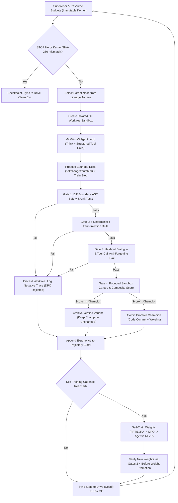

# Self-Maintaining & Bounded Self-Modifying MiniMind-3 (`selfchange`) Engineering Plan

## 1. Executive Vision & Containment Invariants

### 1.1 Goal
Build a closed-loop, self-maintaining, and bounded self-modifying autonomous LLM system inside `selfchange/` using this `minimind` repository as its foundation. The system continuously:
1. **Runs and monitors itself** across operational and training cycles, capturing structured telemetry, logs, and execution traces.
2. **Diagnoses and recovers from failures** (OOM, NaN/Inf loss, syntax/test regressions, corrupted checkpoints, malformed tool calls, stalled progress, VM disconnects).
3. **Improves its own bounded harness/policy code and hyperparameters** inside isolated `git worktree` sandboxes, promoted only after passing an immutable 4-tier verifier and archived in a Darwin Gödel Machine (DGM)-style lineage tree.
4. **Trains its own MiniMind-3 weights** via Rejection-Sampled Fine-Tuning (RFT / LoRA), Direct Preference Optimization (DPO), and Agentic Reinforcement Learning with Verifiable Rewards (RLVR via GRPO / CISPO) so the model gets measurably better at operating, healing, and refining itself over successive generations.

### 1.2 Operational Definition of "Better Keep Itself Run on Its Own"
Self-preservation and autonomy in `selfchange/` are strictly defined as **operational resilience, fault recovery, and reproducible self-improvement** inside user-owned boundaries:
- Detecting and recovering from hardware memory pressure (VRAM/RAM OOM), numerical instability (`NaN`/`Inf` loss or gradient spikes), and runtime exceptions.
- Diagnosing and repairing broken mutable policy/training modules in an isolated `git worktree` using structured file inspection and narrow search-and-replace edits.
- Detecting and recovering from truncated or corrupted checkpoints (critical on Google Colab disconnects) and resuming cleanly from Google Drive state.
- Avoiding catastrophic forgetting, mode collapse, or endless malformed `<tool_call>` loops by continuously curating execution traces into self-training updates.

### 1.3 Hard Safety & Containment Invariants (Non-Negotiable)
1. **Immutable Trusted Computing Base (`selfchange/kernel/`)**: All supervision, budget enforcement, worktree management, AST policy scanning, fault-injection drills, checkpoint/lineage management, and grading live in `selfchange/kernel/`. Before every cycle, `integrity.py` verifies SHA-256 hashes of all kernel files against a signed/pinned manifest; any mismatch halts execution immediately.
2. **Unconditional Shutdown & Human Kill Switch**: The supervisor checks `selfchange/workspace/STOP` before every cycle and sub-step, honors `SIGINT`/`SIGTERM`, and enforces hard wall-clock, disk, RAM/VRAM, and max-cycle limits. The agent has zero mechanism or permission to ignore, suppress, or bypass stop signals or resource limits.
3. **Strict Filesystem & Diff Boundary**: Candidate code execution occurs exclusively inside ephemeral `git worktree` directories under `selfchange/workspace/worktrees/`, and runtime state writes only under `selfchange/workspace/`. A strict `git diff --name-only` gate rejects any candidate patch that touches files outside `selfchange/mutable/`.
4. **No Arbitrary Shell / No Outbound Network in Evaluation**: The MiniMind agent interacts solely through a fixed, typed tool API—never raw `bash`/`sh`. Mutable modules undergo AST static analysis prior to execution to reject forbidden imports and calls (`subprocess`, `socket`, `urllib`, `requests`, `http`, `ctypes`, `eval`, `exec`, `compile`, `__import__`, `os.system`, `os.popen`, `shutil.rmtree` outside workspace).
5. **Immutable Evaluation & Anti-Reward-Hacking**: Reward computation, deterministic fault-injection drills, and regression benchmarks are owned by `selfchange/kernel/`; the model cannot modify test fixtures, grading thresholds, or reward formulas.

---

## 2. Repository Baseline & Repo-Specific Constraints

### 2.1 Reuse Map of Existing `minimind` Components

| Existing Repo Component | Role in `selfchange/` | Notes / Adaptation Needed |
|---|---|---|
| `model/model_minimind.py` | Core `MiniMindConfig` & `MiniMindForCausalLM` (64M Dense: `hidden_size=768`, `num_hidden_layers=8`, `num_attention_heads=8`, `num_key_value_heads=4`, `vocab_size=6400`) | Reused directly; Intel CPU tests also instantiate a 2M micro-model config (`hidden_size=128`, `num_hidden_layers=4`). |
| `model/model_lora.py` | Low-rank self-training (`LoRA`, `apply_lora`, `load_lora`, `save_lora`, `merge_lora`) | Reused for fast RFT cycles; `merge_lora` promotes verified LoRA adapters into updated base `.pth` weights. |
| `model/tokenizer_config.json` | Chat template & special tokens (`<|im_start|>`, `<|im_end|>`, `<think>`, `</think>`, `<tool_call>`, `</tool_call>`, `<tool_response>`, `</tool_response>`, `open_thinking`) | Used verbatim without retraining tokenizer (preserving `vocab_size=6400` weight compatibility). |
| `dataset/lm_dataset.py` | `SFTDataset`, `DPODataset`, `AgentRLDataset` | Reused for warm-start SFT, self-play DPO preference tuning, and multi-turn RLVR rollouts. |
| `trainer/train_lora.py` & `trainer/train_full_sft.py` | Supervised fine-tuning on curated trajectories and synthetic traces | Wrapped by `selfchange/training/self_train_runner.py` to inject profile precision, absolute paths, and structured exit telemetry. |
| `trainer/train_dpo.py` | Preference learning (`dpo_loss`, `beta=0.15`, `lr <= 5e-8`) | Consumes paired `(success, failure)` trajectory tuples on identical tasks/drills. |
| `trainer/train_agent.py` & `trainer/rollout_engine.py` | Multi-turn `<tool_call>` rollout, `TorchRolloutEngine`, `compute_per_token_logps`, GRPO/CISPO policy gradient, `rep_penalty` | Adapted into `selfchange/training/train_self_agent.py` with `reward_model=None` made first-class and deterministic RLVR rewards. |
| `trainer/trainer_utils.py` | `init_model`, `lm_checkpoint`, `get_lr`, `setup_seed`, `safe_math_eval` | Reused directly for atomic checkpointing (`.tmp` + `os.replace`) and cross-step resume. |
| `scripts/convert_model.py` | `convert_transformers2torch`, `convert_torch2transformers`, `convert_merge_base_lora` | Converts HuggingFace/ModelScope `minimind-3` downloads to PyTorch `.pth` (and exports promoted weights if needed). |
| `scripts/eval_toolcall.py` | `TOOLS`, `TEST_CASES`, `parse_tool_calls` | Used as the structural pattern for Gate 3 tool-calling anti-forgetting evaluation. |

### 2.2 Repo-Specific Gotchas & Required Engineering Fixes

1. **64M Capacity & 6400-Vocab Code Density**: MiniMind's 6,400-token BPE vocabulary encodes Python source at roughly 2.5–3.5 characters per token, so long files quickly exhaust context and degrade a 64M model's accuracy. Every file inside `selfchange/mutable/` must stay compact (**40–120 lines**, single responsibility), and code edits must use narrow search-and-replace (`patch_file_replace`) or JSON parameter patches (`patch_config`) rather than full-file rewrites or raw unified diffs.
2. **External Reward Model Coupling in `trainer/train_agent.py`**: Line 436 of `trainer/train_agent.py` unconditionally loads `LMForRewardModel(args.reward_model_path)` (defaulting to `../../internlm2-1_8b-reward`). Loading a 1.8B reward model breaks self-containment and exhausts Intel Mac RAM / Colab T4 memory budgets. `selfchange/training/train_self_agent.py` will treat `reward_model=None` as the default path and compute 100% deterministic verifiable rewards (RLVR) directly from sandbox/verifier outcomes.
3. **Working-Directory Assumptions in `trainer/*.py`**: Existing training scripts assume `cwd == ./trainer` and use relative defaults (`../out`, `../checkpoints`, `../model`, `../dataset/...`). `selfchange/training/self_train_runner.py` must resolve and pass explicit repository-root paths and isolate `save_dir`/`checkpoints` per worktree or workspace stage.
4. **Precision Handling Across Intel x86 CPU vs. CUDA**: `eval_llm.py` calls `.half()` unconditionally (line 31), which fails or degenerates on Intel x86 CPUs, while `train_full_sft.py` / `train_dpo.py` default to `bfloat16`. `selfchange` must enforce backend-aware precision: `float32` on `local_intel_cpu` (`GradScaler` disabled), `float16` on `colab_t4` (`GradScaler` enabled for SFT/LoRA/DPO), and `bfloat16` on `colab_l4_a100`.
5. **LoRA Target Layer Coverage in `model/model_lora.py`**: `apply_lora()` currently attaches `LoRA` only to square `nn.Linear` layers (`module.in_features == module.out_features`, i.e., `q_proj` and `o_proj`). Keep square-only as the low-forgetting default during continuous cycles, and support an optional `selfchange` config flag to include `k_proj`, `v_proj`, `gate_proj`, `up_proj`, `down_proj` during cold-start warm-up while keeping full compatibility with `merge_lora()`.
6. **`eval_llm.py` CLI Bug on `mychanges`**: Line 68 of `eval_llm.py` references `args.input_mode` without defining `--input_mode` in `argparse`. `selfchange` will use its own programmatic model loader and inference wrapper rather than invoking `eval_llm.py` as a subprocess.

---

## 3. Dual Compute Profiles & Google Colab Continuity

Only two target compute environments are supported, switched explicitly via `--profile`:

| Property | `local_intel_cpu` (Dev & CI Mac) | `colab_t4` (Colab Free / Base GPU) | `colab_l4_a100` (Colab Pro GPU) |
|---|---|---|---|
| **Hardware** | Intel Core i7-8850H (`x86_64`), 16 GB RAM, CPU-only (no CUDA, no MLX/MPS) | NVIDIA T4 (16 GB VRAM), ~12.7 GB system RAM | NVIDIA L4 (24 GB) or A100 (40–80 GB) |
| **Model Scale** | Micro-Model (`hidden_size=128`, `num_hidden_layers=4`, ~2M params) for fast smoke loops; 64M Dense only for single-step debug | Full `minimind-3` 64M Dense (`hidden_size=768`, `num_hidden_layers=8`) | Full `minimind-3` 64M Dense (optional `minimind-3-moe` later) |
| **Precision** | `float32` | `float16` (mixed precision + `GradScaler`) | `bfloat16` |
| **Max Seq / Gen Len** | `max_seq_len=384`, `max_gen_len=192`, `max_total_len=640` | `max_seq_len=768`, `max_gen_len=512`, `max_total_len=1536` | `max_seq_len=1024`, `max_gen_len=768`, `max_total_len=2048` |
| **Rollout & Batch** | `batch_size=2`, `num_generations=2`, `num_workers=0` | `batch_size=2`, `num_generations=4`, `num_workers=2` | `batch_size=4`, `num_generations=4–8`, `num_workers=4` |
| **Cycle Time Cap** | 90–180s per full smoke/drill cycle | 8–15 min per autonomous cycle | 4–8 min per autonomous cycle |
| **Persistence** | Local disk (`selfchange/workspace/`) | Ephemeral `/content` mirrored to Google Drive | Ephemeral `/content` mirrored to Google Drive |

### 3.1 Colab T4 (16 GB VRAM) Memory Budget for 64M `minimind-3`
Because `train_self_agent.py` drops the 1.8B external reward model:
- Policy weights (`64M` fp16) + master fp32 optimizer states (AdamW) + gradients: ~1.1 GB.
- Frozen reference model (`64M` fp16, `requires_grad=False`): ~0.13 GB.
- Rollouts & forward/backward activations (`batch_size=2`, `num_generations=4`, `max_total_len=1536`): ~2.5–4.0 GB.
- **Total peak VRAM**: ~4–6 GB, leaving >10 GB headroom on a 16 GB T4 and avoiding sudden OOM cascades.

### 3.2 Google Colab Continuity Protocol (`colab_sync.py` & `colab_launcher.py`)
Google Colab VMs can disconnect or preempt after idle timeouts or 4–12 hour limits. Continuity is guaranteed without manual babysitting:
1. **Drive Mirror Root**: `/content/drive/MyDrive/minimind_selfchange/` stores:
   - `manifest.json` (current `champion_id`, `champion_commit`, `cycle_index`, `consecutive_failures`, `safe_mode`, SHA-256 checksums of artifacts).
   - `archive.jsonl` & `trajectories.jsonl` (append-only, flushed with atomic temp-file writes before sync).
   - `champion/` (latest verified `champion.pth`, `mutable_snapshot.tar.gz`, and active LoRA/optimizer resume checkpoint if mid-training).
   - `HEARTBEAT.json` (PID, timestamp, active cycle phase).
2. **Idempotent Re-Entrant Launcher (`selfchange/colab/colab_launcher.py`)**:
   - Mounts Google Drive -> clones/pulls repo into fast local NVMe (`/content/minimind`) -> copies verified champion weights, mutable commit/snapshot, and `archive.jsonl` from Drive to local `selfchange/workspace/` -> validates `kernel/` SHA-256 manifest -> resumes `supervisor.py` from `cycle_index + 1` (or resumes an interrupted trainer via `--from_resume 1`).
3. **Checkpoint Cadence & Retention**: Syncs to Drive at the end of every cycle (and every `save_interval` during long SFT/RL runs), retaining only the current champion, previous rollback champion, and top-2 archive ancestors on Drive to stay well within Drive storage quotas.

---

## 4. Architecture: Immutable Kernel vs. Mutable Self

### 4.1 Closed-Loop Execution & Evolution Flow



### 4.2 Directory Layout

```text
selfchange/
├── plan.md                         # This architecture & implementation plan
├── kernel/                         # IMMUTABLE TCB (SHA-256 checked before every cycle)
│   ├── __init__.py
│   ├── kernel_manifest.sha256      # Pinned checksums of all kernel/ files
│   ├── integrity.py                # Verifies kernel SHA-256s + git diff boundary checks
│   ├── budgets.py                  # Compute profiles (local_intel_cpu, colab_t4, colab_l4_a100)
│   ├── worktree.py                 # Ephemeral git worktree creation, branch tagging, cleanup
│   ├── sandbox.py                  # Subprocess runner (rlimit, timeout, scrubbed env) + AST policy checker
│   ├── fault_drills.py             # 5 deterministic self-healing / survival fault-injection drills
│   ├── verifier.py                 # 4-tier immutable verifier & composite scoring engine
│   ├── registry.py                 # Atomic champion pointer, DGM lineage archive.jsonl, GC
│   ├── colab_sync.py               # Atomic Google Drive mirror & resume protocol
│   └── supervisor.py               # Outer autonomous daemon, heartbeat, escalation ladder
├── mutable/                        # AGENT-EDITABLE ONLY (40-120 lines per file, narrow scope)
│   ├── __init__.py
│   ├── config.json                 # Tunable runtime/inference/training/curriculum parameters
│   ├── prompts.py                  # Concise system/diagnostic/tool prompts for 64M context
│   ├── recovery_policy.py          # Diagnosis & remediation rules for OOM/NaN/crash/corruption
│   ├── data_curator.py             # Trace quality filter, deduplicator, DPO pairing, replay mixer
│   ├── train_recipe.py             # Adaptive stage/hyperparameter selector (RFT/DPO/RLVR)
│   └── agent_loop.py               # Multi-turn diagnose -> plan -> patch -> test orchestrator
├── bootstrap/                      # Pure MiniMind-3 preparation ladder (zero external LLM)
│   ├── setup_base.py               # Downloads minimind-3 (Colab) or builds micro-model (Mac)
│   ├── eval_baseline.py            # 5-tier initial LLM quality scorecard & Bootstrap-Ready gate
│   ├── midtrain_code.py            # Stage 0.5 Python/logs/JSON continued mid-training wrapper
│   ├── generate_traces.py          # Deterministic 3-rung + AST-mutation synthetic trace generator
│   ├── warmstart_sft.py            # Stage 1 progressive curriculum full-SFT / extended-LoRA warm-start
│   └── offline_rft_dpo.py          # Stage 1.5 offline pass@8 rejection sampling + contrastive DPO bridge
├── training/                       # Self-training execution wrappers
│   ├── self_train_runner.py        # Profile-aware wrapper for LoRA / SFT / DPO / RLVR
│   └── train_self_agent.py         # Self-contained RLVR trainer (GRPO/CISPO, reward_model=None)
├── colab/
│   ├── colab_launcher.py           # Re-entrant Colab bootstrap + Drive restore + supervisor launch
│   └── run_selfchange.ipynb        # Thin Colab notebook entry point
├── tests/
│   ├── test_kernel_integrity.py    # SHA-256 tamper detection & diff-boundary rejection
│   ├── test_sandbox_security.py    # AST blocks forbidden imports/primitives; rlimit timeouts
│   ├── test_fault_drills.py        # Validates all 5 fault drills fail-closed & pass on reference policy
│   ├── test_worktree_lifecycle.py  # Atomic worktree spawn, patch, verify, rollback, GC
│   └── test_e2e_micro_loop.py      # Full autonomous cycle smoke test on local_intel_cpu
└── workspace/                      # GITIGNORED runtime state (never committed to main branch)
    ├── archive.jsonl               # DGM lineage graph (node_id, parent_id, commit, weight, scores)
    ├── trajectories.jsonl          # All tool-call episodes for RFT/DPO/RLVR curation
    ├── models/                     # Base, champion, and candidate weights
    ├── checkpoints/                # Resumable training checkpoints
    ├── worktrees/                  # Ephemeral candidate git worktrees
    ├── logs/                       # Structured JSONL cycle & training telemetry
    └── STOP                        # Creating this file triggers clean immediate shutdown
```

---

## 5. Structured Tool API for 64M Self-Operation & Bounded Code Editing

Because MiniMind-3 is 64M parameters with a 6,400-token vocabulary, the tool surface must be **small, orthogonal, line-addressed, and strictly schema-validated** via `<tool_call>` JSON blocks (matching `model/tokenizer_config.json`):

| Category | Tool Signature | Purpose & Constraints |
|---|---|---|
| **Observe** | `get_system_state()` | Returns compact JSON: compute profile, free RAM/VRAM/disk, champion ID, consecutive failure count, recent loss/reward trend, and last fault code. |
| **Observe** | `read_log_tail(log_name, lines=40)` | Reads the last `N` (`<= 80`) lines of `cycle.log` or `train.log` to diagnose crashes/NaNs without blowing context. |
| **Observe** | `get_archive_summary(top_k=5)` | Returns top-K lineage nodes `(node_id, parent_id, survival_score, eval_score, status)` for informed parent/rollback selection. |
| **Read/Edit** | `list_mutable_files()` | Lists files inside worktree `selfchange/mutable/` with line counts and SHA-256 prefixes. |
| **Read/Edit** | `read_file_lines(path, start=1, end=60)` | Line-numbered read restricted strictly to `selfchange/mutable/` (`<= 80` lines per call). |
| **Read/Edit** | `patch_file_replace(path, target, replacement)` | Exact single-occurrence search-and-replace inside worktree `selfchange/mutable/*.py`. Immediately parses AST + runs `py_compile` + AST safety check; auto-reverts and returns concise error line if invalid. |
| **Read/Edit** | `replace_line_range(path, start_line, end_line, lines)` | Line-indexed replacement inside worktree `selfchange/mutable/*.py` using a JSON list of short lines (`lines: list[str]`), avoiding brittle multi-line JSON string escaping. Immediately validates AST + `py_compile`. |
| **Read/Edit** | `patch_config(updates)` | Schema-validated partial merge into worktree `selfchange/mutable/config.json` (clamps `learning_rate`, `batch_size`, `max_seq_len`, `lora_rank` within safe profile bounds). |
| **Read/Edit** | `revert_file(path)` | Restores a mutable file inside the worktree to the parent commit if an edit goes wrong. |
| **Test/Train** | `run_worktree_checks()` | Runs unit tests + AST check on the current worktree and returns concise pass/fail + traceback tail. |
| **Test/Train** | `curate_experience(mode)` | Runs `mutable/data_curator.py` to build fresh `rft.jsonl` / `dpo.jsonl` / `rlvr_prompts.jsonl` splits from `trajectories.jsonl`. |
| **Test/Train** | `run_training_job(stage, overrides)` | Executes bounded `lora` / `sft` / `dpo` / `rlvr` step inside sandbox budget (`stage` + capped epochs/steps). |
| **Decide** | `submit_candidate(hypothesis)` | Freezes worktree diff + candidate weights and triggers the immutable 4-tier verifier. |
| **Decide** | `rollback_to_ancestor(node_id)` | Switches active working parent to a previously verified archive node when current lineage stalls. |

### Why This Design Works at 64M Scale
- **No full-file regeneration**: Rewriting 300 lines of Python consumes ~1,000+ tokens and introduces bracket/indent errors in small models. Modifying 3–15 lines inside a 40–120 line file via `replace_line_range` or `patch_file_replace` keeps edits inside a reliable ~50–150 token window.
- **Staged Edit Graduation (L0 → L1 → L2)**: Start autonomous operation at **Level 0 (`patch_config`)** and **Level 1 (`replace_line_range` on small mutable files)**; unlock **Level 2 (`patch_file_replace`)** only once the model clears Tier 3 exact-match and `pass@1` gates.
- **Compact Pre-Digested Context & Optional Grammar Guard**: The kernel pre-digests raw tracebacks into concise 5–10 line fault cards (`error_type`, `file`, `line`, `failing_expr`), and rollout inference can optionally enforce lightweight `<tool_call>` JSON prefix/tool-name constraints to eliminate syntax noise during early bootstrap.
- **Immediate local syntax & AST feedback**: When an edit returns a line-specific syntax/AST error inside the `<tool_response>`, the 64M model can self-correct on the very next turn rather than wasting an entire verification run.
- **Safe config-first evolution**: When code edits aren't needed, `patch_config` gives 100% schema-safe hyperparameter adaptation (e.g., halving `batch_size` or `lr` after an OOM or NaN spike).

---

## 6. 4-Tier Immutable Verification, Fault-Injection Drills & RLVR Rewards

No code edit or newly trained weight is ever promoted directly. Every candidate `(worktree_diff, candidate_weights)` must clear all four immutable gates in `selfchange/kernel/verifier.py`:

### 6.1 The 4 Promotion Gates

1. **Gate 1 — Boundary, Static Safety & Unit Hygiene**
   - `kernel/` SHA-256 manifest matches.
   - `git diff --name-only` contains **only** paths matching `^selfchange/mutable/`.
   - AST static checker verifies zero forbidden imports/calls across `selfchange/mutable/*.py`.
   - `python -m py_compile` and `pytest selfchange/tests/test_kernel_integrity.py selfchange/tests/test_sandbox_security.py` + worktree mutable smoke tests pass.

2. **Gate 2 — Operational Survival Drills (`kernel/fault_drills.py`)**
   Five deterministic, reproducible fault-injection scenarios test whether the candidate's `recovery_policy.py` + `agent_loop.py` + candidate weights can keep the system running:
   - **Drill A (Simulated OOM Recovery)**: Injects memory allocation failure (`CUDA out of memory` / `MemoryError`) during training; candidate must halve `batch_size` / increase `accumulation_steps` or shorten `max_seq_len` via `patch_config` and cleanly re-run within budget.
   - **Drill B (Numerical Instability / NaN Loss)**: Injects a training log containing `loss: nan` and gradient norm explosion; candidate must diagnose divergence, lower `learning_rate` / enable tighter `grad_clip`, restore last healthy checkpoint, and confirm finite loss on retry.
   - **Drill C (Broken Mutable Module Repair)**: Seeds the sandboxed worktree with a deterministic planted bug in a mutable file (e.g., syntax typo, inverted OOM backoff formula, or failing assertion); candidate must inspect traceback, `read_file_lines`, fix via `patch_file_replace`, and verify `run_worktree_checks()` passes.
   - **Drill D (Corrupted / Partial Checkpoint Recovery — Colab Preemption Drill)**: Corrupts the latest `_resume.pth` or drops mid-epoch state; candidate must detect checksum failure, fall back to last verified checkpoint/Drive snapshot, and resume cleanly without losing lineage.
   - **Drill E (Malformed Tool-Call / Context Overflow Loop)**: Feeds noisy/truncated logs and tests whether the model avoids infinite repetition, recovers valid `<tool_call>` JSON formatting, and exits within `max_turns`.

3. **Gate 3 — Anti-Forgetting & Core Capability Regression**
   - Fixed held-out perplexity / cross-entropy check on a static validation slice of general dialogue + tool-call examples (`max_ppl_regression <= 5%` over base `minimind-3`).
   - Deterministic tool-call benchmark adapted from `scripts/eval_toolcall.py` (`TEST_CASES` + `parse_tool_calls`): tool-call JSON validity and task pass rate must meet or exceed the floor threshold (`>= baseline - 2%`).

4. **Gate 4 — Bounded Canary Cycle & DGM Lineage Scoring**
   - Candidate runs 1 complete bounded live cycle inside the sandbox under wall-clock, RAM/VRAM, and disk caps.
   - Composite Fitness Score:
     $$S_{\text{total}} = 0.45 \cdot S_{\text{survival}} + 0.30 \cdot S_{\text{eval}} + 0.15 \cdot S_{\text{self\_repair}} + 0.10 \cdot S_{\text{efficiency}}$$
   - **Promotion Rule**: Candidate becomes the new `champion` only if Gates 1–3 pass **and** $S_{\text{total}} > S_{\text{champion}} + \epsilon$ (or equal score with strictly lower resource cost / failure rate). Every Gate 1–3 passing variant is stored in `archive.jsonl` (DGM style) so later cycles can sample diverse high-performing ancestors instead of getting trapped in a single local optimum.

### 6.2 Deterministic RLVR Reward Formula (`train_self_agent.py`)
Used during online multi-turn Agentic RL (`GRPO` / `CISPO`) without any external reward model:

For rollout trajectory $\tau$ on a sandbox task or fault drill:
- **Format & Protocol Validity** ($R_{\text{fmt}} \in [-1.0, +0.5]$): `+0.25` for clean `<think>...</think>` closure (`20 <= len <= 400` chars when `open_thinking=True`), `+0.25` for 100% valid `<tool_call>` JSON blocks; `-0.5` per unclosed tag or malformed JSON call.
- **Diagnostic & Action Grounding** ($R_{\text{act}} \in [0.0, +0.5]$): `+0.25` for observing state/logs/files before editing; `+0.25` for passing AST/schema validation on first edit attempt.
- **Outcome Verification** ($R_{\text{out}} \in [-1.0, +2.0]$): `+2.0` if target fault drill or worktree check resolves end-to-end and passes Gate 1–2; `-1.0` if candidate crashes, leaves worktree failing, or violates diff boundaries.
- **Penalties**: `-rep_penalty(text)` (reusing `trainer/train_agent.py:rep_penalty`), `-0.5` if `unfinished` at `max_turns`, `-0.25` for exceeding wall-clock or step budget.
- **Total Clipped Reward**: $R(\tau) = \text{clip}(R_{\text{fmt}} + R_{\text{act}} + R_{\text{out}} - \text{penalties},\ -3.0,\ +3.0)$.

---

## 7. Data Strategy: What to Collect & Generate

To keep a pure 64M `minimind-3` system self-contained without external teacher APIs or an external reward model, every training sample must belong to one of three verified buckets formatted natively for [lm_dataset.py](file:///Users/admin/Documents/GitHub/minimind/dataset/lm_dataset.py) (`SFTDataset`, `DPODataset`, `AgentRLDataset`) and [tokenizer_config.json](file:///Users/admin/Documents/GitHub/minimind/model/tokenizer_config.json).

### 7.1 Bucket A — Deterministic Synthetic Bootstrap Data (Pure Python, Pre-Autonomy)
`bootstrap/generate_traces.py` constructs **5,000–20,000 verified multi-turn conversations** on Colab (`500` on Mac micro-model smoke tests) across four trace families:
1. **Parametric Fault-to-Recovery Traces (~35%)**: Synthesizes realistic `get_system_state` snapshots and `read_log_tail` excerpts with randomized numeric values (VRAM, batch size, LR, step counts, grad norm, loss) mapped deterministically to recovery rules:
   - `CUDA out of memory` / `MemoryError` → `patch_config` halving `batch_size`, raising `accumulation_steps`, or shrinking `max_seq_len`.
   - `loss: nan` / grad norm explosion → lower `learning_rate`, tighten `grad_clip`, restore last healthy checkpoint.
   - Corrupted `_resume.pth` / `EOFError` → restore last verified checkpoint or `rollback_to_ancestor`.
   - Stagnant reward / high repetition → adjust sampling/curriculum parameters or toggle `config_only`.
2. **AST Mutation-Inversion Code-Repair Traces (~35%)**: Produces authentic Python code-repair traces without any external LLM:
   - Starts from clean 40–120 line modules in `selfchange/mutable/*.py` (plus compact helper fixtures).
   - Uses Python `ast` to inject a single deterministic bug (`<`↔`<=`, `* 0.5`↔`* 2.0`, `min`↔`max`, missing `.get()` default, `ZeroDivisionError`, variable typo, wrong threshold).
   - Runs real `py_compile` / `pytest` in a temporary worktree to capture the **authentic Python traceback**.
   - Emits the exact multi-turn trajectory: `run_worktree_checks()` → real traceback / fault card → `read_file_lines(...)` → concise `<think>` naming the root cause → `replace_line_range(...)` or `patch_file_replace(...)` (exact inverse of the mutation) → `run_worktree_checks()` passing → `submit_candidate(...)`.
3. **Tool-Error Self-Correction Traces (~15%)**: Deliberately plants one recoverable error mid-trajectory (`target not found`, `SyntaxError`, out-of-range `patch_config` parameter) followed by `read_file_lines` and a corrected second edit so the model learns to recover instead of repeating broken calls.
4. **Safe Abstention / No-Op & Rollback Traces (~15%)**: Healthy system states where the right action is leaving working code untouched, plus multi-failure streaks calling `rollback_to_ancestor(node_id)`.

### 7.2 Bucket B — Live Operational Experience (`workspace/trajectories.jsonl`)
Every live cycle and sandboxed drill is recorded with messages, tool calls, responses, Gate 1–4 scores, peak RAM/VRAM, wall-clock duration, and failure tags, then curated by `mutable/data_curator.py`:
- **RFT Positive Buffer (`SFTDataset`)**: Episodes clearing Gates 1–4 (`rep_penalty < 0.15`), deduplicated by `(task_family, tool_call_signature)` and prioritizing newly solved hard drills or improved mutations.
- **DPO Preference Pairs (`DPODataset`: `{"chosen": [...], "rejected": [...]}`)**: Built automatically when sampling `K = 4–8` rollouts on the **same** fault drill or AST-mutated bug—pairing a verified pass (`chosen`) against a real failure (`rejected`: malformed JSON, unclosed `<think>`, editing without reading, `target not found` loops, test failure, diff-boundary violation, or high repetition).
- **Parameterized RLVR Task Bank (`AgentRLDataset`)**: Procedural fault-drill and AST-bug generators (seed + mutation spec) so online `GRPO`/`CISPO` in `train_self_agent.py` never overfits a static prompt list.

### 7.3 Bucket C — Real Anchor & Anti-Forgetting Replay Data
- Sample **10,000–30,000** clean examples from MiniMind's official datasets (`sft_t2t_mini.jsonl`, `agent_rl.jsonl`, `agent_rl_math.jsonl`, `dpo.jsonl`).
- Mix **20–30% anchor data** into every SFT/RFT batch to prevent catastrophic forgetting.
- Maintain a **strictly frozen 500–1,000 sample held-out validation split** never touched during training.

### 7.4 Bucket D — Data Hygiene & What Not to Collect
- **Reject unverified self-generated prose**: Never train on raw model outputs that did not pass deterministic verification.
- **Enforce `token_len <= 0.9 * max_seq_len`**: `SFTDataset.__getitem__` in [lm_dataset.py](file:///Users/admin/Documents/GitHub/minimind/dataset/lm_dataset.py#L114) hard-truncates at `[:self.max_length]`, which silently drops closing `</tool_call>` or `<|im_end|>` tokens if logs or files aren't trimmed first.
- **Deduplicate trivial wins**: Cap repeated identical easy-drill trajectories so the buffer stays balanced across failure modes.

---

## 8. Quantifying Initial LLM Quality (5-Tier Baseline Scorecard)

Before any self-training or autonomous loop runs, `bootstrap/eval_baseline.py` benchmarks the untouched `minimind-3` checkpoint (and the 2M Mac micro-model for harness validation) across **5 orthogonal tiers** using fixed seeds at `temperature=0.0` (`pass@1`) and `temperature=0.7` (`pass@4`):

1. **Tier 1 — Language & Python Fluency Floor (Anti-Forgetting Baseline)**
   - Held-out loss / perplexity (PPL) and Bits-Per-Byte (BPB) on `500` masked `sft_t2t_mini` dialogues and `100` short clean Python functions from this repo.
   - Generation hygiene: clean `<|im_end|>` termination rate, mean 3-gram `rep_penalty`, and empty/degenerate output rate.
2. **Tier 2 — Tool-Call Protocol Fidelity (Interface Readiness)**
   - Evaluated on ~50 expanded generic cases from [eval_toolcall.py](file:///Users/admin/Documents/GitHub/minimind/scripts/eval_toolcall.py#L45-L54) plus ~50 `selfchange` tool prompts:
   - **Tag Balance Rate** (`<think>...</think>` and `<tool_call>...</tool_call>`), **JSON Parse Rate**, **Schema Validity Rate** (valid tool name + required argument types), **Hallucinated Tool Rate**, and **Observation Copy Fidelity** (% accurately reproducing exact line numbers, paths, or values from `<tool_response>`).
3. **Tier 3 — Bounded Code-Editing Precision (Self-Modification Readiness)**
   - Evaluated on 50–100 held-out AST-injected bugs across 40–120 line Python modules (syntax/typo, single-line logic, multi-line fix):
   - **`target` Exact-Match Rate**, **AST / `py_compile` Valid Patch Rate**, and **Bug-Fix `pass@1` vs. `pass@4`**.
   - Comparing `pass@1` vs. `pass@4` separates missing base knowledge (`pass@4 ≈ 0%` → SFT required) from policy calibration (`pass@4 >> pass@1` → ready for RFT/DPO/RLVR).
4. **Tier 4 — Operational Survival Drills (Drills A–E Baseline)**
   - All 5 fault drills from Section 6.1 across 10 randomized parameter seeds each (**50 episodes total**): per-drill resolution rate, mean turns to recovery, budget compliance, and **Healthy No-Op Preservation Rate**.
5. **Tier 5 — Hardware & Throughput Calibration (Mac vs. Colab T4)**
   - Prefill/decode `tokens/s` at context lengths `512 / 1024 / 1536`, peak RAM/VRAM per stage (inference, LoRA, DPO, GRPO `num_generations=4`), and total Gate 2–3 wall-clock duration (target `< 60–90s` on Colab T4).

### 8.1 Go / No-Go Diagnostic Table

| Observed Baseline Signal | Diagnosis | Required Action |
|---|---|---|
| Generic `eval_toolcall` JSON parse `>= 80%`, `selfchange` tools `< 20%`, code `pass@4 < 10%` | Normal cold-start gap (model knows `<tool_call>`, not `selfchange` tools or Python repair) | Execute the 6-Step Preparation Ladder (Section 9.2). |
| After warm-start: `patch_file_replace` exact-match `< 50%` | 64M struggles with verbatim multi-line quoting under 6,400 BPE | Stay at L1 `replace_line_range(path, start_line, end_line, lines)` and keep mutable files `< 80` lines. |
| After warm-start: `pass@4 >= 40%` while `pass@1 < 30%` | Capability exists in distribution; policy needs sharpening | Run Stage 1.5 offline RFT + DPO, then enter Stage 2/3 RLVR. |
| Held-out dialogue PPL rises `> 5%` or `eval_toolcall` drops `> 2%` | Early catastrophic forgetting | Raise Bucket C anchor ratio to `35–40%`, lower LR, or tighten DPO/RL KL `beta`. |

---

## 9. Preparing a Bootstrap-able LLM & Closed-Loop Self-Training Curriculum

### 9.1 Why Untouched 64M `minimind-3` Fails Naive Bootstrap
Without deliberate preparation, an off-the-shelf 64M `minimind-3` checkpoint will almost certainly fail a zero-shot bootstrap:
1. **Domain Mismatch**: `minimind-3` was trained for general Chinese/English chat and 6 simple JSON tools, not Python AST editing, stack-trace diagnosis, or config recovery.
2. **6,400-Vocab Code Friction**: Python tokens expand densely (~2.5–3.5 chars/token), making verbatim multi-line JSON string escaping brittle.
3. **Zero-Advantage RL Cliff**: In `trainer/train_agent.py` line 317 (`advantages = (rewards - mean_r) / (std_r + 1e-4)`), if `pass@4 ≈ 0%`, every rollout in a group gets the same failure reward (`std_r == 0`) → **zero gradient**, zero RFT positives, and zero DPO `chosen` pairs.
4. **Multi-Turn Horizon Drift**: Uncalibrated 64M models often lose tool state or repeat previous calls over 3–5 turns.

### 9.2 The 6-Step Pre-Autonomy Preparation Ladder
The bootstrap phase solves this from both ends—**lowering the task difficulty** and **raising the model's baseline capability**—before handing over autonomous control:

1. **Step 1 — Base Acquisition & Untouched Baseline (`bootstrap/setup_base.py` + `eval_baseline.py`)**:
   - **On Google Colab**: Download `minimind-3` (`64M`, `hidden_size=768`, `num_hidden_layers=8`), convert to PyTorch `.pth` via `scripts/convert_model.py:convert_transformers2torch` if needed, and download `sft_t2t_mini.jsonl` + `dpo.jsonl` + `agent_rl.jsonl` anchor slices. Run `eval_baseline.py` to record Tier 1–5 ground truth.
   - **On Local Intel Mac**: Initialize a deterministic 2M micro-model (`hidden_size=128`, `num_hidden_layers=4`, `vocab_size=6400`, seed=42) + 200 synthetic anchor samples to validate every script on CPU.
2. **Step 2 — Lower the Bootstrap Barrier (Interface Co-Design)**:
   - Start with **L0 (`patch_config`)** and **L1 (`replace_line_range`)** instead of raw string-matching diffs; pre-digest raw tracebacks into concise 5–10 line fault cards; optionally enable constrained `<tool_call>` prefix/tool-name decoding.
3. **Step 3 — Stage 0.5: Python + Logs + JSON Continued Mid-Training (`bootstrap/midtrain_code.py`)**:
   - Triggered if Tier 1 Python PPL is weak: run `trainer/train_pretrain.py` at low LR (`1e-5`–`5e-5`, starting from `full_sft` or `pretrain`) on 50–300 MB of clean short Python functions, stdlib snippets, pytest tracebacks, and structured JSON mixed **50/50** with `pretrain_t2t_mini` (~30–60 min on Colab T4).
4. **Step 4 — Stage 1: 3-Rung Progressive Curriculum SFT (`bootstrap/generate_traces.py` + `warmstart_sft.py`)**:
   - *Rung 1 (3K–5K traces)*: Atomic single-turn skills (fault-log classification, single valid `<tool_call>`, 1-line AST fix from a 20-line snippet, verbatim line-copy drill).
   - *Rung 2 (5K–8K traces)*: 2-turn observe → act trajectories (`read_log_tail`→`patch_config`, `read_file_lines`→`replace_line_range`).
   - *Rung 3 (5K–10K traces)*: Full 3–5 turn repair + 1-error self-correction + healthy no-op/rollback, blended **70/30** with Bucket C anchor data.
   - *Capacity Choice*: Use **full-parameter SFT (`trainer/train_full_sft.py`)** or expanded-target LoRA (`q_proj`, `k_proj`, `v_proj`, `o_proj`, `gate_proj`, `up_proj`, `down_proj`) to install new Python editing skills, reserving square-only LoRA (`model/model_lora.py`) for low-forgetting online cycles.
5. **Step 5 — Stage 1.5: Offline Rejection Sampling + Contrastive DPO Calibration (`bootstrap/offline_rft_dpo.py`)**:
   - Sample `N = 8` rollouts (`temperature=0.7`) across 200–500 procedural drills & AST bugs.
   - Run 1 round of RFT SFT on passing trajectories (`pass@8`) + 1 round of `trainer/train_dpo.py` (`lr <= 5e-8`, `beta=0.15`) pairing winners vs. failures on identical prompts.
   - Repeat 1–2 offline rounds until `pass@1` climbs close to `pass@8`.
6. **Step 6 — Hard "Bootstrap-Ready" Entry Gate (Mandatory Before Autonomous Cycles)**:
   Autonomy (`supervisor.py`) is unlocked **only** when the prepared model passes all of:
   - **Tier 1**: General dialogue PPL regression `<= +5%`, EOS rate `>= 95%`, mean `rep_penalty < 0.10`.
   - **Tier 2**: `selfchange` Tool JSON parse `>= 95%`, Schema validity `>= 90%`, Observation copy fidelity `>= 90%`.
   - **Tier 3**: Held-out single-line AST bug `pass@1 >= 40%`, `pass@4 >= 70%`, AST/`py_compile` valid `>= 85%`.
   - **Tier 4**: Drills A–E combined resolution `>= 70%` (`>= 80%` on config drills), Healthy no-op preservation `>= 90%`.

### 9.3 Capacity Escape Hatches (If 64M Dense Plateaus Below Step 6)
1. **In-Repo Architecture Scale-Up**: Swap base weights from Dense `64M` to **`minimind-3-moe` (`198M-A64M`, 4 experts / top-1)**—providing ~3× parameter capacity at ~64M active compute—or a deeper Dense configuration (`768 × 16L`, ~115M) on Colab L4/A100.
2. **Staged Autonomy Graduation**: Enter autonomous operation strictly in **L0/L1 mode (`patch_config` + `replace_line_range` / parameterized policy slots)** where 64M reliably exceeds 70% pass rate, and unlock L2 freeform `patch_file_replace` only once Tier 3 `pass@1 >= 50%`.
3. **Optional One-Time Pre-Bootstrap Trace Distillation**: If deterministic `<think>` templates lack reasoning diversity, optionally run a one-time offline distillation pass in Step 4 (via `trainer/train_distillation.py` or an open-weight model on Colab), then sever all external dependencies before autonomous execution.

### 9.4 Post-Bootstrap Closed-Loop Self-Training (`Stage 2 RFT/DPO` & `Stage 3 Agentic RLVR`)
Once the Step 6 gate is cleared, continuous self-improvement runs inside the autonomous loop:
- **Stage 2 — Live RFT + DPO**:
  - *RFT (LoRA)*: Curate verified positive trajectories (`S_total >= champion` or newly solved hard drills), blend with **25% Bucket C anchor replay**, train bounded `train_lora.py` updates (`rank=16`, `epochs=1–2`), and run `merge_lora()` **only** after passing Gates 2–4.
  - *DPO (`trainer/train_dpo.py`)*: Pair multi-rollout winners (`chosen`) against failures (`rejected`) on identical drills/bugs and train with conservative hyperparameters (`lr <= 5e-8`, `beta=0.15`).
- **Stage 3 — Agentic RLVR (`training/train_self_agent.py`)**:
  - Adapted from `trainer/train_agent.py` + `trainer/rollout_engine.py`: runs multi-turn rollouts directly against `fault_drills.py` and seeded worktree repair tasks (`num_generations=4`, `max_turns=4`, `loss_type="cispo"` or `"grpo"`, `beta=0.1` KL penalty to frozen `ref_model`, `thinking_ratio=0.5`, **`reward_model=None`**).
  - Normalizes advantages per prompt group using the deterministic RLVR reward from Section 6.2 and gates weight promotion strictly through Gates 2–4.

### 9.5 Anti-Collapse & Anti-Forgetting Safeguards
- **Fixed Anchor Replay**: 20–30% real dialogue/tool samples (`sft_t2t_mini.jsonl`) in every SFT/RFT batch.
- **Frozen Reference KL Anchor**: DPO (`beta=0.15`) and GRPO/CISPO (`beta=0.1`) constrain policy drift away from the last verified champion.
- **Atomic Weight Promotion**: Weights are staged in `workspace/models/candidate_*.pth` and promoted only after passing Gates 2–4.
- **Stagnation Detection**: If tool-call diversity collapses or `rep_penalty` spikes across 2 cycles, freeze code edits, trigger conservative DPO/anchor recovery, or roll back to the best verified ancestor in `archive.jsonl`.

---

## 10. Autonomous Runtime State Machine & Failure Escalation

### 10.1 Per-Cycle Lifecycle (`kernel/supervisor.py`)
1. **Pre-Flight Check**: Check `STOP` file; verify `kernel/` SHA-256 manifest; check disk free space, RAM/VRAM headroom, and Colab session remaining budget.
2. **Parent Selection (`kernel/registry.py`)**: Sample parent `(commit, weights)` from `archive.jsonl` (70% current champion exploitation, 30% probabilistic selection from top-K verified diverse ancestors weighted by survival score and inverse child count—preventing evolutionary dead ends).
3. **Sandbox Spawn (`kernel/worktree.py`)**: Create ephemeral worktree `selfchange/workspace/worktrees/cand_<id>/` pinned to parent commit.
4. **Autonomous Episode (`mutable/agent_loop.py`)**: Run MiniMind-3 within `max_turns` and `cycle_timeout_sec` (observing state/logs, optionally proposing config/code changes or running bounded diagnostics/training).
5. **Immutable Verification (`kernel/verifier.py`)**: Run Gates 1 → 4 on candidate `(worktree, weights)`. Record outcome (pass or fail) as structured experience in `trajectories.jsonl`.
6. **Commit / Promote or Discard**:
   - On full pass + score improvement: commit mutable patch to lineage branch, merge/save verified weights atomically, update `champion` pointer, append node to `archive.jsonl`.
   - On failure or non-improvement: discard worktree (`git worktree remove --force`), log failure trace as DPO `rejected` candidate.
7. **Self-Training Cadence**: Every $N$ cycles (or when sufficient verified positive/negative pairs accumulate), invoke `self_train_runner.py` (RFT -> DPO -> RLVR), then verify new weights through Gates 2–4 before promoting.
8. **Persistence & GC**: Mirror state to Google Drive (`colab_sync.py`), prune worktrees and stale intermediate checkpoints beyond retention cap.

### 10.2 Three-Level Failure Escalation Ladder
- **Level 1 (Single-Cycle Candidate Failure)**: Syntax error, Gate 1–4 rejection, or single runtime exception → discard worktree immediately, increment `consecutive_failures`, record negative trace for DPO, proceed to next cycle.
- **Level 2 (Streak Failure: `consecutive_failures >= 3`)**: Enter **Safe Mode**—disable code self-modification temporarily (`config_only=True`), roll back to the highest-scoring stable ancestor in `archive.jsonl`, halve training batch size & learning rate, and run Gate 2 recovery drills to stabilize.
- **Level 3 (Critical / Unrecoverable Failure)**: Kernel SHA-256 integrity mismatch, disk exhaustion after GC, repeated Safe Mode failures (`>= 2`), or unrecoverable CUDA device error → write diagnostic report to `workspace/logs/fatal_report.json`, flush checkpoints & `archive.jsonl` to Google Drive, and **halt cleanly** (`exit(1)` or `STOP` sentinel) rather than thrashing hardware.

---

## 11. Phased Implementation Roadmap & Verification Milestones

| Phase | Target Env | Key Deliverables | Concrete Verification Exit Criteria |
|---|---|---|---|
| **Phase 1: Immutable Kernel & Worktree Sandbox** | Local Intel Mac (`local_intel_cpu`) | `kernel/integrity.py`, `budgets.py`, `worktree.py`, `sandbox.py`, `registry.py`, `supervisor.py`, `tests/test_kernel_integrity.py`, `test_sandbox_security.py`, `test_worktree_lifecycle.py` | `pytest selfchange/tests/test_kernel*.py selfchange/tests/test_sandbox*.py selfchange/tests/test_worktree*.py` passes 100%; simulated tamper of `kernel/` aborts pre-flight; patch touching `trainer/` is rejected by Gate 1; AST check blocks `subprocess`/`socket`/`eval`. |
| **Phase 2: Fault Drills & 4-Tier Verifier** | Local Intel Mac (`local_intel_cpu`) | `kernel/fault_drills.py`, `kernel/verifier.py`, `mutable/` initial baseline (`config.json`, `prompts.py`, `recovery_policy.py`, `data_curator.py`, `train_recipe.py`, `agent_loop.py`), `tests/test_fault_drills.py` | Deterministic scripted baseline solves all 5 drills (OOM, NaN, syntax bug, corrupted checkpoint, malformed tool loop) in `< 30s`; injected unfixed faults fail deterministically; `STOP` file halts loop cleanly within 1 step. |
| **Phase 3: Baseline Scorecard & Bootstrap Preparation Ladder** | Local Intel Mac (2M micro) -> Colab T4 (64M) | `bootstrap/setup_base.py`, `eval_baseline.py`, `midtrain_code.py`, `generate_traces.py`, `warmstart_sft.py`, `offline_rft_dpo.py`, `training/self_train_runner.py` | On Mac: `eval_baseline.py` runs all 5 tiers on 2M micro-model; generates 500 3-rung + AST traces, runs 1-epoch CPU `float32` SFT + offline RFT/DPO smoke test, completes 1 full `tests/test_e2e_micro_loop.py` cycle in `< 3 min`. On Colab T4: runs untouched `minimind-3` baseline, executes Steps 2–5, and clears **Step 6 Bootstrap-Ready Gate** (Tier 2 JSON `>= 95%`, Tier 3 `pass@1 >= 40%` / `pass@4 >= 70%`, Drills `>= 70%`). |
| **Phase 4: Weight Self-Training Loop (RFT + DPO + RLVR)** | Google Colab T4 / L4 / A100 | `training/train_self_agent.py` (with `reward_model=None`), live `data_curator.py` pairing, closed-loop RFT/DPO/CISPO cycles in L0 `config_only` mode | 64M model completes 5+ consecutive weight self-training cycles on Colab T4 without OOM/NaN; Gate 2 survival score and Gate 3 tool-call accuracy strictly improve or hold above floor with `<= 5%` dialogue PPL drift. |
| **Phase 5: Bounded Code Self-Modification & Lineage Archive** | Local Intel Mac (smoke) + Google Colab (64M) | Staged graduation from L1 `replace_line_range` to L2 `patch_file_replace` on `selfchange/mutable/*.py` + DGM `archive.jsonl` multi-branch parent selection | System autonomously proposes, tests, and promotes at least 1 valid `mutable/` improvement (e.g., refined `recovery_policy.py` or `train_recipe.py`) via Gates 1–4, rejects injected broken/unsafe edits without corrupting `champion`, and recovers cleanly via ancestor rollback during stagnation test. |
| **Phase 6: Colab Drive Continuity & Unattended Soak Test** | Google Colab T4 / L4 + Google Drive | `kernel/colab_sync.py`, `colab/colab_launcher.py`, `colab/run_selfchange.ipynb` | Simulate mid-cycle VM kill / disconnect: relaunch `colab_launcher.py` from Drive, confirm exact restoration of `champion`, `archive.jsonl`, and checkpoint state without duplicate corruption; complete an unattended multi-hour soak run (10+ cycles). |

---

## 12. Risks, Bottlenecks & Mitigations

| Risk / Bottleneck | Impact | Concrete Mitigation |
|---|---|---|
| **Cold-Start Bootstrap Failure / Zero-Advantage RL Cliff** | Untouched 64M `minimind-3` achieves `pass@4 ≈ 0%`, causing `std_r == 0` in GRPO/CISPO and zero valid RFT/DPO traces. | Never launch autonomy raw: run the 6-Step Preparation Ladder (Section 9.2), measure `pass@1`/`pass@4` via `eval_baseline.py`, enforce the Step 6 Bootstrap-Ready Gate, and fall back to L0/L1 mode or `minimind-3-moe` (`198M-A64M`) if 64M Dense plateaus. |
| **64M Model Code-Edit Ceiling** | High risk of syntax mistakes or wrong line edits in large Python files. | Keep `selfchange/mutable/*.py` strictly 40–120 lines; start at L1 `replace_line_range` before L2 `patch_file_replace`; give instant AST/syntax traceback inside `<tool_response>`; warm-start on AST mutation-inversion traces; always keep L0 `config_only` fallback. |
| **6,400-Vocab Code Tokenization Overhead** | Python keywords/indentation expand into more tokens (~2.5–3.5 chars/token), risking context overflow or silent `SFTDataset` truncation. | Enforce concise prompts (`prompts.py`), pre-digested 5–10 line fault cards, bounded `read_file_lines(..., <= 80)`, `read_log_tail(..., <= 40)`, and `token_len <= 0.9 * max_seq_len` filtering. |
| **Reward Hacking / Goodhart's Law** | Model learns to pass trivial self-checks or skip difficult tasks to earn reward. | Lock `fault_drills.py`, `verifier.py`, and Gate 3 benchmarks inside SHA-256-verified `kernel/`; combine survival drills with held-out PPL/tool regression and explicit `rep_penalty`. |
| **Model Collapse / Catastrophic Forgetting** | Recursive training on self-generated text degrades language coherence and diversity. | Require 20–30% real/anchor replay (`sft_t2t_mini.jsonl`) in RFT/SFT, KL penalties in DPO (`beta=0.15`) and GRPO/CISPO (`beta=0.1`), and atomic post-verification weight promotion. |
| **Google Colab Preemption & Drive Latency** | Sudden VM shutdown loses in-progress worktrees/weights; frequent large writes to Drive stall training. | Sync only compressed champion snapshots, `archive.jsonl`, and latest resume checkpoint at cycle boundaries; keep all ephemeral worktrees and raw step logs on fast local `/content` SSD. |
| **Local Intel Mac CPU Constraints** | 64M multi-turn RL rollouts on CPU `float32` would take hours per cycle. | Strict profile separation: Intel Mac validates 100% of kernel/worktree/drill/RL logic using the 2M micro-model in `< 3 min`; 64M self-training runs exclusively on Colab GPUs. |
| **Disk Exhaustion from Worktrees & Checkpoints** | Repeated `git worktree` clones and `.pth` saves fill 16–80 GB disks quickly. | Auto-remove rejected worktrees immediately; enforce checkpoint retention GC (keep champion + previous champion + top-2 ancestors) and check disk free quota pre-cycle. |
